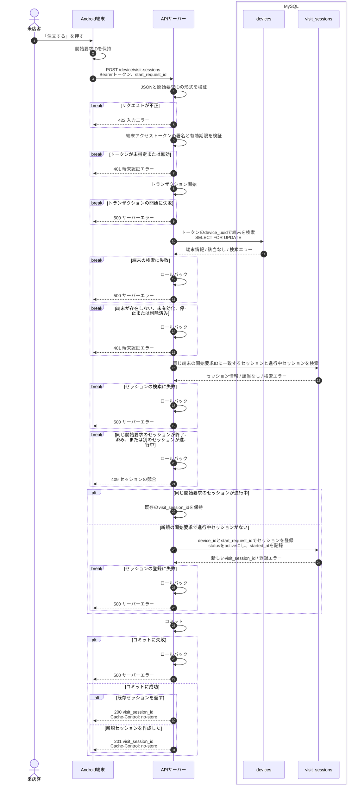

# 来店セッション開始 API

## 前提

- 来店客が「注文する」を押すと、Android 端末がこの API を呼ぶ。
- Android 端末は [端末アクセストークン発行 API](端末アクセストークン発行.md)で取得したトークンを使う。応答を受け取れず再送するときは、同じ開始要求 ID を使う。
- セッションの確認と登録は、対象端末の行を排他ロックしたうえで、同じトランザクション内で行う。
- 本書は [メニューオーダーフローの来店セッション開始](../../メニューオーダーフロー.md#21-来店セッション開始カテゴリー選択)の詳細設計。リクエストとレスポンスの形式、HTTP ステータスは本書で定める設計案とする。

| 項目 | 内容 |
| --- | --- |
| Method | `POST` |
| Path | `/device/visit-sessions` |
| Authentication | `Authorization: Bearer <access_token>` |
| Request | JSON の `start_request_id`（必須、空白だけの値を除く1〜64文字の文字列） |
| Response | `visit_session_id`（整数） |
| Response Header | 成功時に `Cache-Control: no-store` |

リクエスト例

```json
{
  "start_request_id": "b93c8a2b-5464-47b2-b87d-e36e7f2a64e4"
}
```

成功レスポンス例

```json
{
  "visit_session_id": 123
}
```

| ステータス | 条件 |
| --- | --- |
| `200` | 同じ開始要求 ID に対応する進行中のセッションを返した |
| `201` | 新規セッションを作成した |
| `401` | 端末アクセストークンが未指定・無効・期限切れ、または対象端末が存在しない、未有効化・停止・削除済み |
| `409` | 同じ開始要求 ID に対応するセッションが終了済み、または別のセッションが進行中 |
| `422` | JSON が不正、または `start_request_id` が未指定、文字列以外、空、空白のみ、64文字超 |
| `500` | トランザクションの開始、DB検索・登録、またはコミットに失敗 |

## シーケンス図



## 入力検証・更新条件

- `start_request_id` は1〜64文字の文字列とし、空白だけの値は入力エラーとする。端末は新規の開始操作ごとに ID を生成し、同じ操作を再送するときは保持している ID を使う。
- 検証済みのトークンに含まれる `device_uuid` で端末を特定する。行を排他ロックした後に `activated_at IS NOT NULL`、`is_active = TRUE`、`deleted_at IS NULL` を確認する。 [DB構成](../../DB構成.md#310-devices)
- `active`（注文受付中）と `checkout_processing`（決済処理中）を進行中とし、端末ごとに合計1件までとする。端末行をロックしたトランザクション内で、端末の利用可否確認からセッションの検索・登録までを行う。 [DB構成](../../DB構成.md#311-visit_sessions)
- `(device_id, start_request_id)` は一意とする。同じ開始要求のセッションが進行中なら既存の ID を返す。該当セッションが `closed`（終了済み）か、別の開始要求のセッションが進行中なら `409` を返す。
