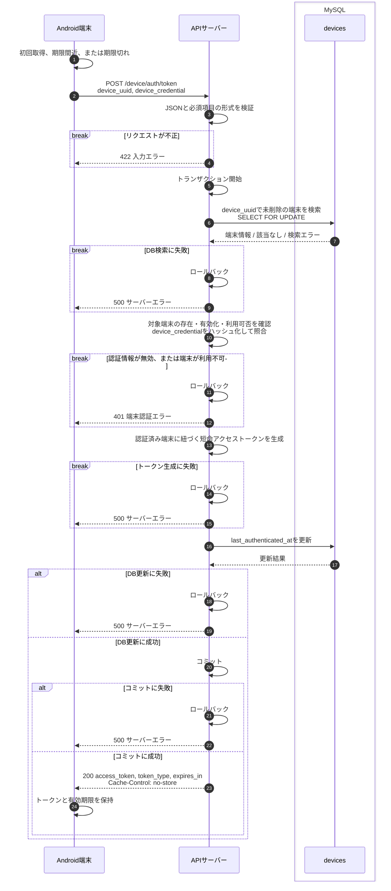

# 端末アクセストークン発行 API

## 前提

- Android 端末は [端末初回有効化 API](端末初回有効化.md)から受け取った `device_uuid` と `device_credential` を保護して保存している。
- 端末は初回取得時、有効期限が近づいたとき、または期限切れになったときに、保存した端末認証情報で同じ API を呼び出す。
- 端末状態と認証情報の確認から最終認証日時の保存までは同じトランザクション内で行う。
- 本書は [メニューオーダーフローの端末アクセストークン取得](../../メニューオーダーフロー.md#12-端末アクセストークンの取得)の詳細設計。リクエストとレスポンスの形式、HTTP ステータスは本書で定める設計案とする。

| 項目 | 内容 |
| --- | --- |
| Method | `POST` |
| Path | `/device/auth/token` |
| Authentication | `device_uuid` と `device_credential` を照合。Bearer トークンは不要 |
| Request | JSON の `device_uuid`（必須、UUID 文字列）と `device_credential`（必須、空でない文字列） |
| Response | `access_token`、`token_type`（`Bearer`）、`expires_in`（有効期間、秒） |
| Response Header | `Cache-Control: no-store` |

リクエスト例

```json
{
  "device_uuid": "3ef42a83-9fc8-4418-ac59-148328719672",
  "device_credential": "EXAMPLE_DEVICE_CREDENTIAL"
}
```

成功レスポンス例

```json
{
  "access_token": "EXAMPLE_ACCESS_TOKEN",
  "token_type": "Bearer",
  "expires_in": 300
}
```

| ステータス | 条件 |
| --- | --- |
| `200` | 端末認証に成功し、最終認証日時を保存した |
| `401` | 端末が存在しない、認証情報が一致しない、または端末が未有効化・停止・削除済み |
| `422` | `device_uuid` または `device_credential` が未指定、文字列以外、または形式不正 |
| `500` | DB検索、トークン生成、最終認証日時の更新、またはコミットに失敗 |

## シーケンス図



## 入力検証・更新条件

- `device_uuid` は UUID 形式、`device_credential` は空でない文字列とする。
- `deleted_at IS NULL` の端末を照会し、`activated_at IS NOT NULL`、`is_active = TRUE`、`device_credential_hash IS NOT NULL` を確認する。受け取った `device_credential` は初回有効化時と同じ方式で SHA-256 ハッシュ化し、保存済みの値と照合する。認証失敗時は端末の登録や停止の状態を区別せず、共通の `401` を返す。 [DB構成](../../DB構成.md#310-devices)
- 行を排他ロックして認証し、成功時に `last_authenticated_at` を更新する。コミットが完了してからトークンを返す。
- 発行後の端末向け API では、トークンを検証し、リクエストごとに端末の利用可否を確認する。端末認証情報とアクセストークンの平文をログに出力しない。
- アクセストークンは端末専用の署名鍵で署名した HS256 JWT とする。有効期間は `device_jwt_expire_seconds` で設定し、既定値は300秒。期限前の再取得を開始するタイミングは端末側で決める。
