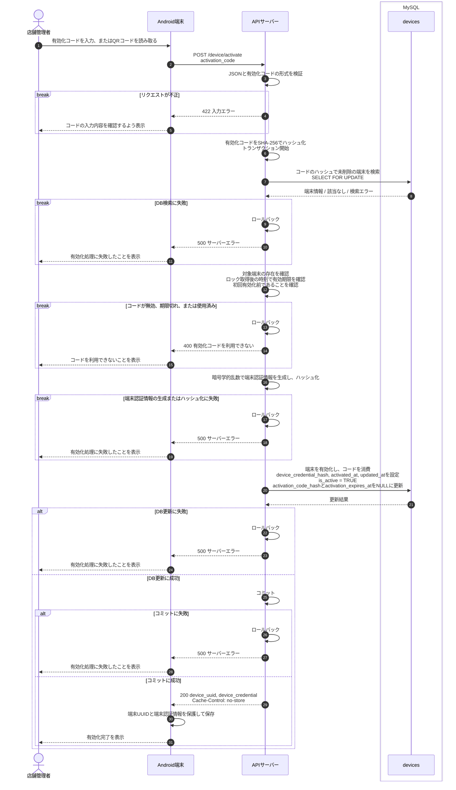

# 端末初回有効化 API

## 前提

- 店舗管理者が端末を事前登録し、[有効化コード発行 API](../管理者用API/デバイス管理.md#デバイス有効化コード発行-api)で発行したコードを設置時に Android 端末へ設定する。
- 端末は有効化コードを使って初回有効化する。端末 UUID は事前登録時に発行された値を返す。
- コードの照合と消費は同じトランザクション内で行う。同じコードが同時に送信されても、有効化できるのは1リクエストだけとする。
- 本書は [メニューオーダーフローの初回有効化](../../メニューオーダーフロー.md#11-事前登録と初回有効化)の詳細設計。リクエストとレスポンスの形式、HTTP ステータスは本書で定める設計案とする。

| 項目 | 内容 |
| --- | --- |
| Method | `POST` |
| Path | `/device/activate` |
| Authentication | 有効化コードを照合。Bearer トークンは不要 |
| Request | JSON の `activation_code`（必須、文字列） |
| Response | `device_uuid`、初回有効化時に発行する `device_credential` |
| Response Header | `Cache-Control: no-store` |

リクエスト例

```json
{
  "activation_code": "ABCD-EFGH-JKLM"
}
```

成功レスポンス例

```json
{
  "device_uuid": "3ef42a83-9fc8-4418-ac59-148328719672",
  "device_credential": "EXAMPLE_DEVICE_CREDENTIAL"
}
```

| ステータス | 条件 |
| --- | --- |
| `200` | 端末の有効化に成功 |
| `400` | コードが一致しない、期限切れ、使用済み、または対象端末が削除済み |
| `422` | `activation_code` が未指定、文字列以外、または形式不正 |
| `500` | DB検索、端末認証情報の生成・ハッシュ化、DB更新、またはコミットに失敗 |

## シーケンス図



## 入力検証・更新条件

- `activation_code` は発行時の形式に合わせ、`ABCDEFGHJKLMNPQRSTUVWXYZ23456789` の文字を4文字ずつ、ハイフンで区切った3組とする。ハイフンを含む文字列を UTF-8 として SHA-256 でハッシュ化する。
- 対象は `activation_code_hash` が一致し、`deleted_at IS NULL` の端末とする。行を排他ロックした後に、`activation_expires_at` が現在時刻より後で、`activated_at` と `device_credential_hash` がともに `NULL` であることを確認する。
- コードが再発行済みの場合、以前のコードはハッシュが一致しない。有効化に成功した後も、再送されたコードはハッシュが一致しない。該当なし、期限切れ、使用済みの場合は同じエラーレスポンスを返す。
- DBには有効化コードと端末認証情報のハッシュを保存する。端末認証情報の平文はコミット後の成功レスポンスで一度だけ返し、有効化コードと端末認証情報の平文はいずれもログに出力しない。 [DB構成](../../DB構成.md#310-devices)
