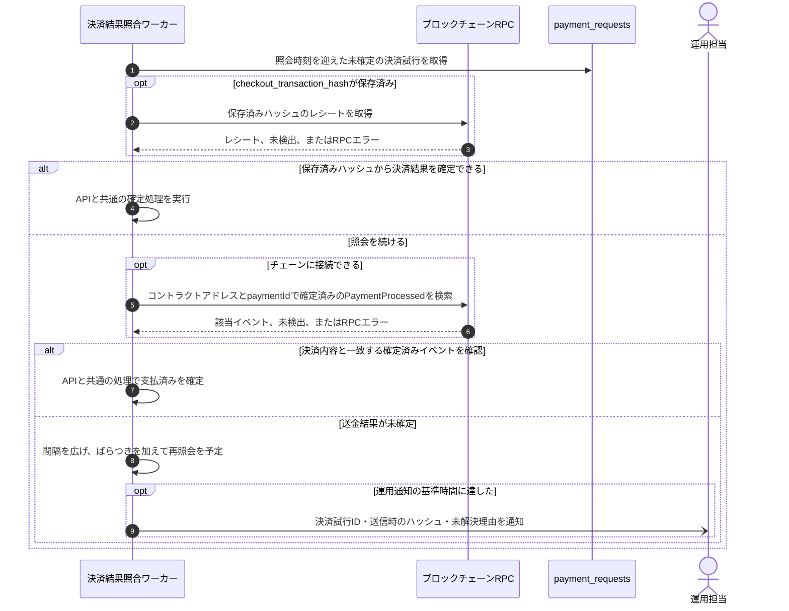

# 決済結果照合ワーカー

## 前提

- ワーカーは HTTP リクエストとは独立して未確定の決済試行を照合する。結果の確定には [決済結果確認 API](../デバイス用API/決済結果確認.md#シーケンス図) と同じ処理を使う。

## シーケンス図

## 照合・更新条件

- 端末の接続状況にかかわらず、ワーカーは `requested`、`submitted`、`confirming` の決済試行を継続照合する。運用通知後も照合を続ける。対象注文の再決済は、元の送金が未成立で、今後も成立しないことを確認してから許可する。
- 保存済みハッシュで結果を確定できない場合は、決済開始時点以降の確定済みブロックで `PaymentProcessed` を検索する。別トランザクションのイベントでも、設定済みコントラクト、`paymentId`、トークン、送金元、送金先、金額がすべて一致すれば支払済みとして確定する。端末からの API 照会とワーカーの照合が並行した場合も、同じ確定処理で保存済みの状態を再確認する。
- 初期対応では照会を継続し、長時間未解決の場合は運用担当へ通知する。`expires_at` の経過後も、元の送金が成立し得る間は決済結果を処理中として扱う。

## 未確定事項

- ワーカーの照会間隔、運用通知までの時間。
- 未確定の署名済みトランザクションを再送する条件と、元の送金が成立しないことを確認して試行を失効扱いにする方法。
