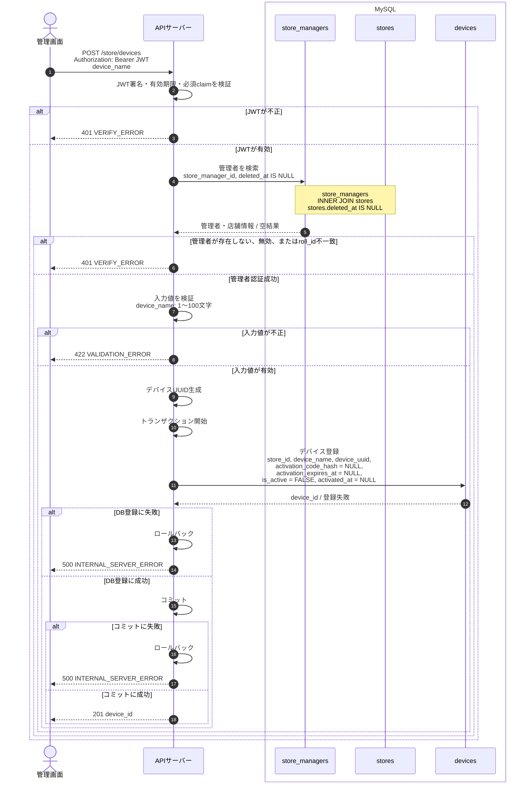
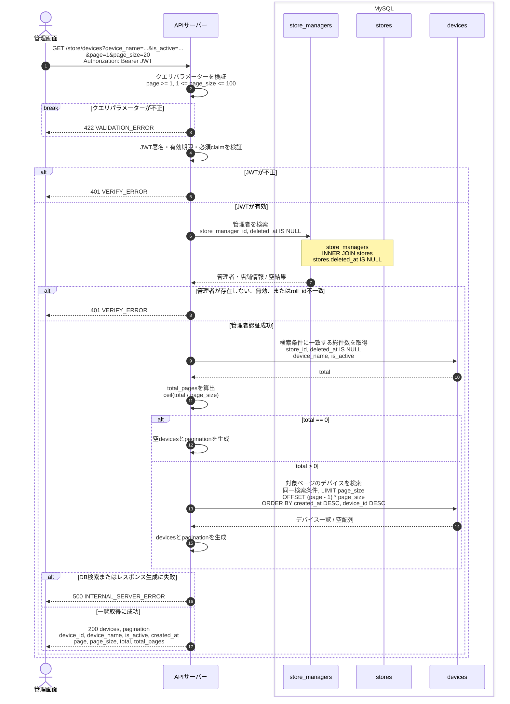
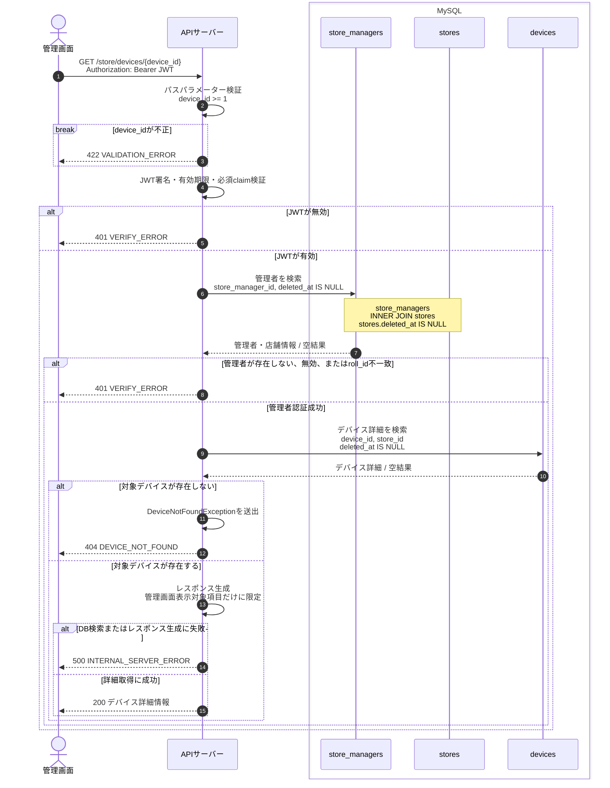
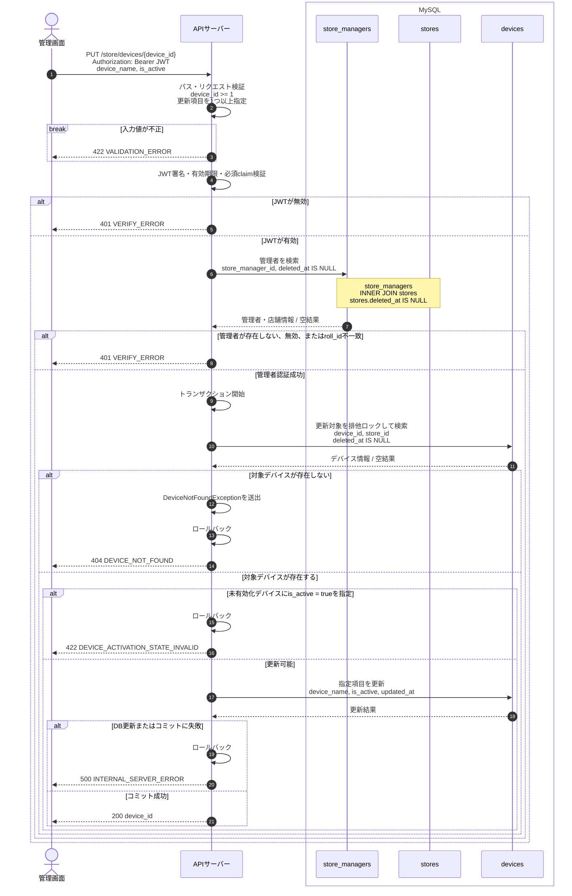
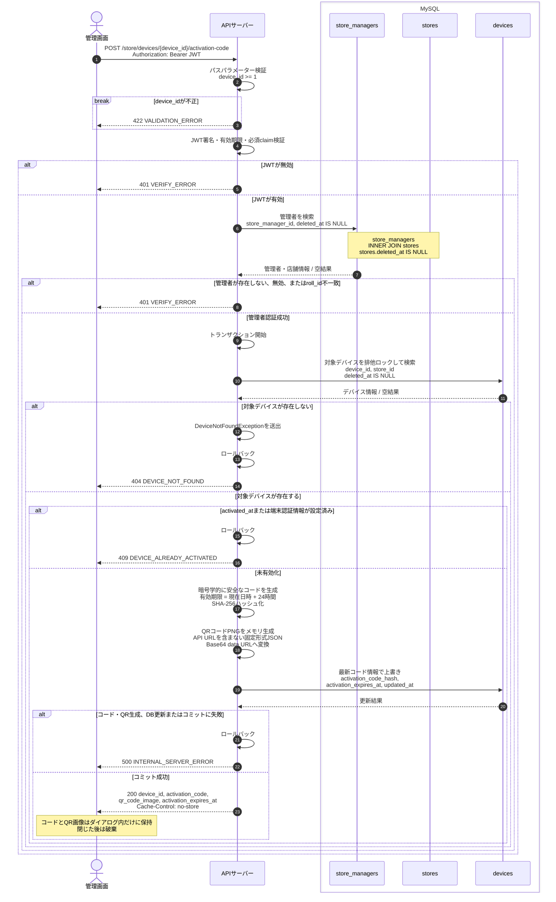

# デバイス管理 API

## デバイス登録 API

### 前提

- 店舗管理者をJWTアクセストークンで認証し、対象の `store_id` はトークンに紐付く管理者情報から取得する。リクエストでは `store_id` を受け取らない。
- デバイス登録時はUUIDだけを生成し、有効化コードは発行しない。
- `activation_code_hash` と `activation_expires_at` は `null` で登録し、実際に端末設定を行うときに有効化コード発行APIで設定する。
- 登録直後のデバイスは未有効化とし、`is_active = false`、`activated_at = null` で登録する。
- デバイス登録はDBトランザクション内で実行する。

| 項目 | 内容 |
| --- | --- |
| Method | `POST` |
| Path | `/store/devices` |
| Authentication | `Authorization: Bearer <JWT>` |
| Request | `device_name` |
| Response | 登録したデバイスID |

リクエスト例:

```json
{
  "device_name": "レジ端末1"
}
```

正常レスポンス例:

```json
{
  "device_id": 1
}
```

| ステータス | 条件 |
| --- | --- |
| `201` | デバイス登録成功 |
| `401` | JWTが未指定、不正、期限切れ、または管理者が無効 |
| `422` | `device_name` の入力値が不正 |
| `500` | UUID生成、DB登録、コミット、またはレスポンス生成に失敗 |

### シーケンス図



### 入力制限

- `device_name` は空文字を許可せず、1〜100文字とする。

## デバイス一覧取得 API

### 前提

- 店舗管理者をJWTアクセストークンで認証し、対象の `store_id` はトークンに紐付く管理者情報から取得する。リクエストでは `store_id` を受け取らない。
- 認証済み管理者の店舗に属する未削除デバイスのみを取得する。
- `device_name` はデバイス名の部分一致、`is_active` は有効状態の完全一致で検索する。複数条件はANDで組み合わせる。
- `page` は1以上、`page_size` は1〜100とし、未指定時はそれぞれ `1`、`20` を使用する。
- デバイスは `created_at`、`device_id` の降順で返す。該当するデバイスがない場合は空配列を返す。
- 各デバイスは `device_id`、`device_name`、`is_active`、`created_at` のみ返す。

| 項目 | 内容 |
| --- | --- |
| Method | `GET` |
| Path | `/store/devices` |
| Authentication | `Authorization: Bearer <JWT>` |
| Request | Query: `device_name`（任意）、`is_active`（任意）、`page`（初期値1）、`page_size`（初期値20、最大100） |
| Response | `device_id`、`device_name`、`is_active`、`created_at` を含むデバイス一覧と `pagination` |

正常レスポンス例:

```json
{
  "devices": [
    {
      "device_id": 1,
      "device_name": "レジ端末1",
      "is_active": false,
      "created_at": "2026-11-16T10:00:00+09:00"
    }
  ],
  "pagination": {
    "page": 1,
    "page_size": 20,
    "total": 1,
    "total_pages": 1
  }
}
```

| ステータス | 条件 |
| --- | --- |
| `200` | デバイス一覧取得成功。該当データがない場合は空配列を返す |
| `401` | JWTが未指定、不正、期限切れ、または管理者が無効 |
| `422` | `device_name`、`page`、`page_size`、またはその他の検索条件が不正 |
| `500` | DB検索またはレスポンス生成に失敗 |

### シーケンス図



### 入力制限

- `device_name` は指定する場合、1〜100文字とする。
- `is_active` は真偽値とする。
- `page` は1以上の整数とし、未指定時は `1` とする。
- `page_size` は1〜100の整数とし、未指定時は `20` とする。

## デバイス詳細情報取得 API

### 前提

- 店舗管理者をJWTアクセストークンで認証し、対象の `store_id` はトークンに紐づく管理者情報から取得する。リクエストでは `store_id` を受け取らない。
- 認証済み管理者の店舗に属する未削除デバイスだけを取得する。
- 指定したデバイスが存在しない、論理削除済み、または別店舗に属する場合は `DeviceNotFoundException` を送出し、`404` に変換して返す。
- レスポンスは管理画面で常時表示してよい項目だけに限定する。
- `store_id`、`device_uuid`、`activation_code_hash`、`activation_expires_at`、`device_credential_hash`、`deleted_at` はレスポンスに含めない。

| 項目 | 内容 |
| --- | --- |
| Method | `GET` |
| Path | `/store/devices/{device_id}` |
| Authentication | `Authorization: Bearer <JWT>` |
| Request | Path: `device_id` |
| Response | デバイスID、名称、有効状態、有効化日時、最終認証日時、登録日時、更新日時 |

正常レスポンス例:

```json
{
  "device_id": 1,
  "device_name": "レジ端末1",
  "is_active": false,
  "activated_at": null,
  "last_authenticated_at": null,
  "created_at": "2026-11-16T10:00:00+09:00",
  "updated_at": "2026-11-16T10:00:00+09:00"
}
```

| ステータス | 条件 |
| --- | --- |
| `200` | デバイス詳細情報取得成功 |
| `401` | JWTが未指定、不正、期限切れ、または管理者が無効 |
| `404` | デバイスが存在しない、論理削除済み、または別店舗に所属 |
| `422` | `device_id` が不正 |
| `500` | DB検索またはレスポンス生成に失敗 |

デバイス未存在時のレスポンス例:

```json
{
  "detail": {
    "status": "error",
    "message": "デバイスが存在しません。"
  }
}
```

### シーケンス図



### 入力制限

- `device_id` は1以上の整数とする。

## デバイス更新 API

### 前提

- 店舗管理者をJWTアクセストークンで認証し、対象の `store_id` はトークンに紐づく管理者情報から取得する。リクエストでは `store_id` を受け取らない。
- 認証済み管理者の店舗に属する未削除デバイスだけを更新する。
- 更新対象は `device_name` と `is_active` に限定し、UUIDや端末認証情報は変更しない。
- `is_active = true` への更新は、初回有効化済みで端末認証情報が登録されているデバイスだけ許可する。未有効化デバイスを管理画面から直接有効化しない。
- 指定したデバイスが存在しない、論理削除済み、または別店舗に属する場合は `DeviceNotFoundException` を送出し、`404` に変換して返す。
- 更新処理はDBトランザクション内で実行する。

| 項目 | 内容 |
| --- | --- |
| Method | `PUT` |
| Path | `/store/devices/{device_id}` |
| Authentication | `Authorization: Bearer <JWT>` |
| Request | Path: `device_id`、Body: `device_name`、`is_active`（どちらも任意、少なくとも1項目必須） |
| Response | 更新したデバイスID |

リクエスト例:

```json
{
  "device_name": "1階レジ端末",
  "is_active": false
}
```

正常レスポンス例:

```json
{
  "device_id": 1
}
```

| ステータス | 条件 |
| --- | --- |
| `200` | デバイス更新成功 |
| `401` | JWTが未指定、不正、期限切れ、または管理者が無効 |
| `404` | デバイスが存在しない、論理削除済み、または別店舗に所属 |
| `422` | `device_id`、リクエスト項目、または有効化状態が不正 |
| `500` | DB検索、更新、コミット、またはレスポンス生成に失敗 |

デバイス未存在時のレスポンス例:

```json
{
  "detail": {
    "status": "error",
    "message": "デバイスが存在しません。"
  }
}
```

### シーケンス図



### 入力制限

- `device_id` は1以上の整数とする。
- `device_name` は指定する場合、空文字と空白だけを許可せず、前後の空白を除去した1〜100文字とする。
- `is_active` は真偽値とする。
- `device_name` と `is_active` の少なくとも1項目を指定する。
- 定義されていないリクエスト項目は受け付けない。

## デバイス有効化コード発行 API

### 前提

- 店舗管理者をJWTアクセストークンで認証し、対象の `store_id` はトークンに紐づく管理者情報から取得する。リクエストでは `store_id` を受け取らない。
- 認証済み管理者の店舗に属する未削除デバイスだけを対象とする。
- デバイス登録時にはコードを発行せず、実際に端末設定を行うタイミングで本APIを実行する。
- 未有効化デバイスであれば何度でも発行できる。再発行時は既存コードを即時無効化し、最新のコードだけを有効とする。
- 有効化済みデバイスにはコードを発行しない。
- 平文コードはレスポンスで一度だけ返し、DBにはSHA-256ハッシュ値だけを保存する。
- APIサーバーは有効化情報を格納したQRコードPNGをメモリ上で生成し、Base64形式でレスポンスに含める。QR画像はDB、S3、ローカルファイルへ保存しない。
- QRコードにはデバイス認証APIのURLを含めず、形式識別子、バージョン、有効化コードだけを格納する。端末アプリは自身が保持する正規API URLへコードを送信する。
- 管理画面は平文コードをメモリ上のダイアログだけに保持し、ダイアログを閉じた後は破棄する。再表示が必要な場合は再発行する。
- 平文コード、QR格納内容、Base64画像をアプリケーションログ、アクセスログ、監査ログへ出力しない。
- レスポンスには `Cache-Control: no-store` を設定する。
- 発行処理はDBトランザクション内で対象デバイスを排他ロックして実行する。

| 項目 | 内容 |
| --- | --- |
| Method | `POST` |
| Path | `/store/devices/{device_id}/activation-code` |
| Authentication | `Authorization: Bearer <JWT>` |
| Request | Path: `device_id`。リクエストボディなし |
| Response | デバイスID、平文の有効化コード、Base64形式のQRコードPNG、有効期限 |
| Response Header | `Cache-Control: no-store` |

正常レスポンス例:

```json
{
  "device_id": 1,
  "activation_code": "ABCD-EFGH-JKLM",
  "qr_code_image": "data:image/png;base64,iVBORw0KGgoAAA...",
  "activation_expires_at": "2026-11-18T10:00:00+09:00"
}
```

QRコード格納内容:

```json
{"type":"teraid_pay_device_activation","version":1,"activation_code":"ABCD-EFGH-JKLM"}
```

| ステータス | 条件 |
| --- | --- |
| `200` | 有効化コード発行または再発行成功 |
| `401` | JWTが未指定、不正、期限切れ、または管理者が無効 |
| `404` | デバイスが存在しない、論理削除済み、または別店舗に所属 |
| `409` | デバイスが既に有効化済み |
| `422` | `device_id` が不正 |
| `500` | コード生成、QR画像生成、DB更新、コミット、またはレスポンス生成に失敗 |

### シーケンス図



### 入力・発行制限

- `device_id` は1以上の整数とする。
- 有効化コードは推測困難な暗号学的乱数から生成する。
- 有効化コードの有効期限は発行から24時間とする。
- 発行のたびに既存の `activation_code_hash` と `activation_expires_at` を上書きし、旧コードを無効化する。
- QRコードには `type`、`version`、`activation_code` だけを格納し、API URLや端末用認証情報を含めない。
- QRコードPNGはメモリ上だけで生成し、永続化しない。
- 平文コードとQRコード画像はレスポンス生成後に保持しない。
