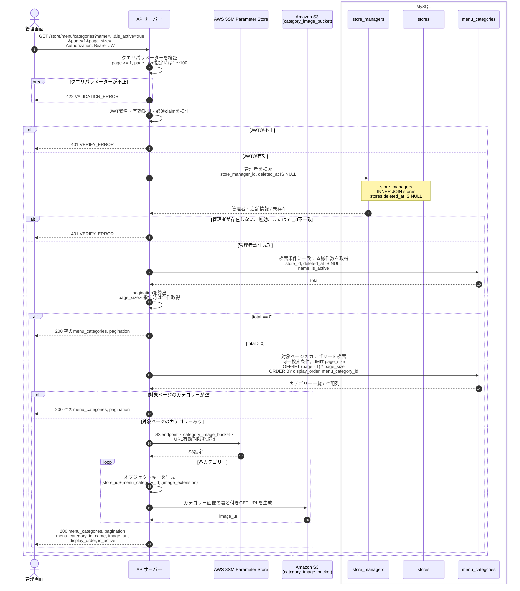
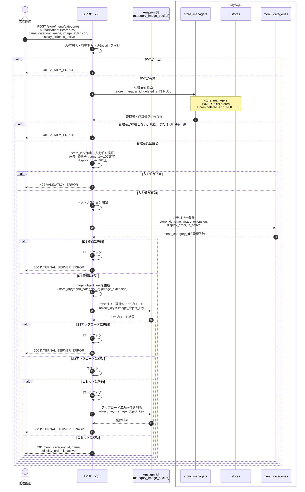
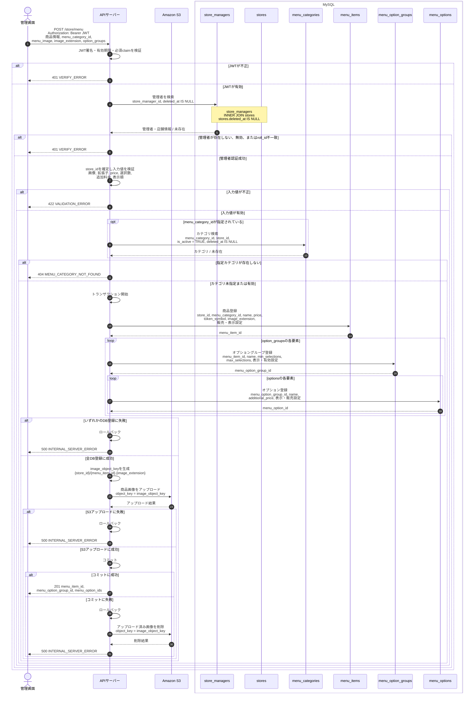
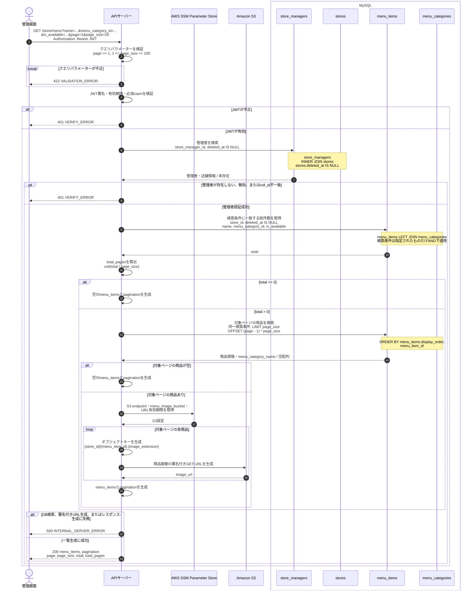

# メニュー管理 API

## 前提

- 店舗管理者のJWTアクセストークンで認証し、対象の `store_id` はトークンに紐づく管理者情報から取得する。リクエストでは `store_id` を受け取らない。
- カテゴリー取得APIは、対象店舗に属する未削除カテゴリーを `name` の部分一致と `is_active` の完全一致で検索し、`display_order`、`menu_category_id` の昇順で返す。`is_active` の未指定時は `true` とする。
- カテゴリー取得APIの `page` は1以上、`page_size` は指定する場合1〜100とする。`page_size` 未指定時はページングせず全カテゴリーを取得し、`pagination.page = 1`、`page_size = null`、`total_pages = 1`（0件の場合は0）を返す。
- カテゴリー画像は `category_image_bucket` の `{store_id}/{menu_category_id}.{image_extension}` から署名付きURLを生成し、`image_url` として返す。URLの有効期限は商品画像と同じ設定値を使用する。
- 1回のリクエストで商品、オプショングループ、オプションを登録する。
- `menu_category_id` は任意とし、指定された場合は同じ店舗に属する有効なカテゴリであることを確認する。
- 商品画像は `menu_image` と `image_extension` で受け取り、本API内でS3へアップロードする。
- `menu_items` には `image_extension` を登録し、S3のオブジェクトキーは `{store_id}/{menu_item_id}.{image_extension}` の形式で生成する。
- 商品、オプショングループ、オプションを同一トランザクション内ですべて登録した後、商品画像をS3へアップロードする。
- S3アップロード成功後にDBトランザクションをコミットする。
- S3アップロード後にコミットが失敗した場合は、アップロード済み画像をS3から削除する。

## カテゴリー取得 API

| 項目 | 内容 |
| --- | --- |
| Method | `GET` |
| Path | `/store/menu/categories` |
| Authentication | `Authorization: Bearer <JWT>` |
| Request | Query: `name`（任意）、`is_active`（既定値true）、`page`（既定値1）、`page_size`（任意、1〜100、未指定時は全件取得） |
| Response | 検索条件に一致するカテゴリー一覧と `pagination`。各カテゴリーに画像の署名付きURLと有効状態を含む |

成功レスポンス例:

```json
{
  "menu_categories": [
    {
      "menu_category_id": 1,
      "name": "ハンバーガー",
      "image_url": "https://example.com/categories/101/1.jpeg?signature=...",
      "display_order": 1,
      "is_active": true
    },
    {
      "menu_category_id": 2,
      "name": "ドリンク",
      "image_url": "https://example.com/categories/101/2.jpeg?signature=...",
      "display_order": 2,
      "is_active": true
    }
  ],
  "pagination": {
    "page": 1,
    "page_size": null,
    "total": 2,
    "total_pages": 1
  }
}
```

| ステータス | 条件 |
| --- | --- |
| `200` | カテゴリー取得成功。該当データがない場合は空配列を返す |
| `401` | JWTが未指定、不正、期限切れ、または管理者が無効 |
| `422` | `name`、`page`、`page_size`、またはその他の検索条件が不正 |
| `500` | DB検索、署名付きURL生成、またはレスポンス生成に失敗 |

### シーケンス図



## カテゴリー登録 API

### 前提

- カテゴリー画像は `category_image` と `image_extension` で受け取り、本API内でS3の `category_image_bucket` へアップロードする。
- `menu_categories` には `image_extension` を登録する。
- `category_image_bucket` 内のS3オブジェクトキーは `{store_id}/{menu_category_id}.{image_extension}` とする。
- S3アップロード成功後にDBトランザクションをコミットする。
- S3アップロード後にコミットが失敗した場合は、アップロード済み画像をS3から削除する。

| 項目 | 内容 |
| --- | --- |
| Method | `POST` |
| Path | `/store/menu/categories` |
| Authentication | `Authorization: Bearer <JWT>` |
| Request | カテゴリー名、`category_image`、`image_extension`、`display_order`、`is_active` |
| Response | 登録したカテゴリーのID、カテゴリー名、表示順、有効フラグ |

リクエスト例:

```json
{
  "name": "ハンバーガー",
  "category_image": "base64-encoded-image",
  "image_extension": "jpeg",
  "display_order": 1,
  "is_active": true
}
```

成功レスポンス例:

```json
{
  "menu_category_id": 1,
  "name": "ハンバーガー",
  "display_order": 1,
  "is_active": true
}
```

| ステータス | 条件 |
| --- | --- |
| `201` | カテゴリー登録成功 |
| `401` | JWTが未指定、不正、期限切れ、または管理者が無効 |
| `422` | カテゴリー画像、拡張子、カテゴリー名、表示順、または有効フラグの入力値が不正 |
| `500` | S3アップロードまたはDB登録に失敗し、DBトランザクションをロールバック |

### シーケンス図



### 入力検証

- `name` は空文字を許可せず、1〜100文字とする。
- `category_image` はBase64形式の画像データとする。
- `image_extension` は許可された画像拡張子とし、`category_image` の実形式と一致させる。
- `display_order` は0以上の整数とし、未指定時は `0` とする。
- `is_active` は真偽値とし、未指定時は `true` とする。

## メニュー登録 API

| 項目 | 内容 |
| --- | --- |
| Method | `POST` |
| Path | `/store/menu` |
| Authentication | `Authorization: Bearer <JWT>` |
| Request | 商品情報、`menu_category_id`、`menu_image`、`image_extension`、`option_groups` |
| Response | 登録した商品、オプショングループ、オプションのID |

リクエスト例:

```json
{
  "menu_category_id": 1,
  "name": "チーズバーガー",
  "description": "チェダーチーズ入り",
  "price": "800.000000",
  "token_symbol": "JPYC",
  "menu_image": "base64-encoded-image",
  "image_extension": "jpeg",
  "is_available": true,
  "display_order": 1,
  "option_groups": [
    {
      "name": "サイズ",
      "min_selections": 1,
      "max_selections": 1,
      "display_order": 1,
      "is_active": true,
      "options": [
        {
          "name": "通常",
          "additional_price": "0.000000",
          "display_order": 1,
          "is_available": true
        },
        {
          "name": "大盛り",
          "additional_price": "100.000000",
          "display_order": 2,
          "is_available": true
        }
      ]
    }
  ]
}
```

成功レスポンス例:

```json
{
  "menu_item_id": 10,
  "menu_option_groups": [
    {
      "menu_option_group_id": 20,
      "menu_option_ids": [30, 31]
    }
  ]
}
```

| ステータス | 条件 |
| --- | --- |
| `201` | メニュー登録成功 |
| `401` | JWTが未指定、不正、期限切れ、または管理者が無効 |
| `404` | 指定カテゴリが登録先店舗に存在しない、無効、または削除済み |
| `422` | 商品画像、拡張子、商品、オプショングループ、またはオプションの入力値が不正 |
| `500` | S3アップロードまたはDB登録に失敗し、DBトランザクションをロールバック |

### シーケンス図



## 入力検証

- `price` は0以上とする。
- `min_selections <= max_selections` かつ `max_selections > 0` とする。
- `additional_price` は0以上とする。
- `menu_image` はBase64形式の画像データとする。
- `image_extension` は許可された画像拡張子とする。
- 指定された `menu_category_id` は、認証済み管理者の `store_id` と一致するカテゴリに限る。

## メニュー一覧取得 API

### 前提

- 店舗管理者のJWTアクセストークンで認証し、対象の `store_id` はトークンに紐づく管理者情報から取得する。リクエストでは `store_id` を受け取らない。
- 管理画面で販売状態を確認できるように、対象店舗の未削除の商品を取得する。`is_available` が `FALSE` の商品も返す。
- `menu_categories` をLEFT JOINし、未削除のカテゴリー名を `menu_category_name` として返す。商品にカテゴリーが紐づかない場合は `menu_category_id` と `menu_category_name` を `null` とする。
- 一覧取得では `menu_option_groups` と `menu_options` を参照せず、オプショングループとオプションは商品詳細APIで取得する。
- 商品は `display_order`、`menu_item_id` の昇順で返す。該当する商品がない場合は空配列を返す。
- 商品画像は `{store_id}/{menu_item_id}.{image_extension}` 形式のオブジェクトキーから、有効期限付きの署名付きURLを生成し、`image_url` として返す。URLの有効期限は設定値で管理する。
- `name` は商品名の部分一致、`menu_category_id` はカテゴリーIDの完全一致、`is_available` は公開状態の完全一致で検索する。複数条件はANDで組み合わせる。
- `page` は1以上、`page_size` は1〜100とし、未指定時はそれぞれ `1`、`20` を使用する。
- 検索条件に一致する総件数を取得した後、`OFFSET = (page - 1) * page_size` と `LIMIT = page_size` を適用して対象ページの商品を取得する。

| 項目 | 内容 |
| --- | --- |
| Method | `GET` |
| Path | `/store/menu` |
| Authentication | `Authorization: Bearer <JWT>` |
| Request | Query: `name`（任意）、`menu_category_id`（任意）、`is_available`（任意）、`page`（既定値1）、`page_size`（既定値20、最大100） |
| Response | 対象ページのメニュー商品一覧と `pagination`。各商品にカテゴリー名と画像URLを含み、オプショングループとオプションは含まない |

成功レスポンス例:

```json
{
  "menu_items": [
    {
      "menu_item_id": 10,
      "menu_category_id": 1,
      "menu_category_name": "ハンバーガー",
      "name": "チーズバーガー",
      "description": "チェダーチーズ入り",
      "price": "800.000000",
      "token_symbol": "JPYC",
      "image_url": "https://example.com/menus/101/10.jpeg?signature=...",
      "is_available": true,
      "display_order": 1
    }
  ],
  "pagination": {
    "page": 1,
    "page_size": 20,
    "total": 35,
    "total_pages": 2
  }
}
```

| ステータス | 条件 |
| --- | --- |
| `200` | メニュー一覧取得成功。該当データがない場合は空配列を返す |
| `401` | JWTが未指定、不正、期限切れ、または管理者が無効 |
| `422` | `page`、`page_size`、その他の検索条件が不正 |
| `500` | DB検索、署名付きURL生成、またはレスポンス生成に失敗 |

### シーケンス図


