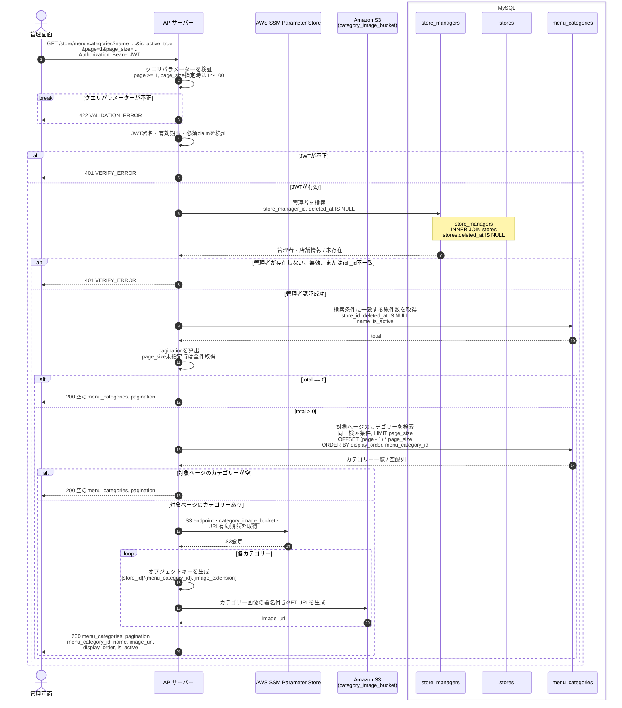
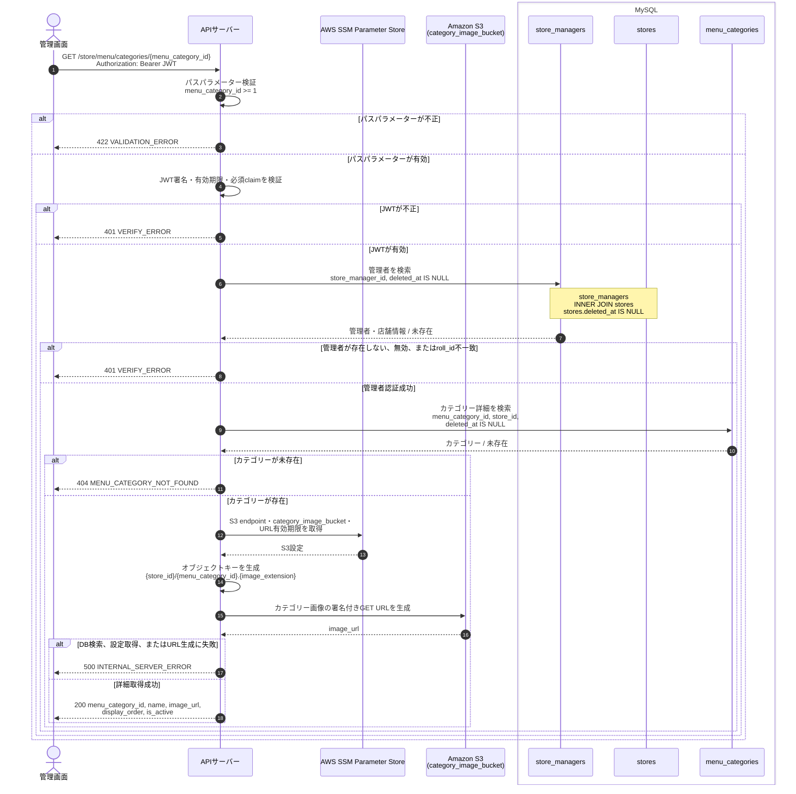
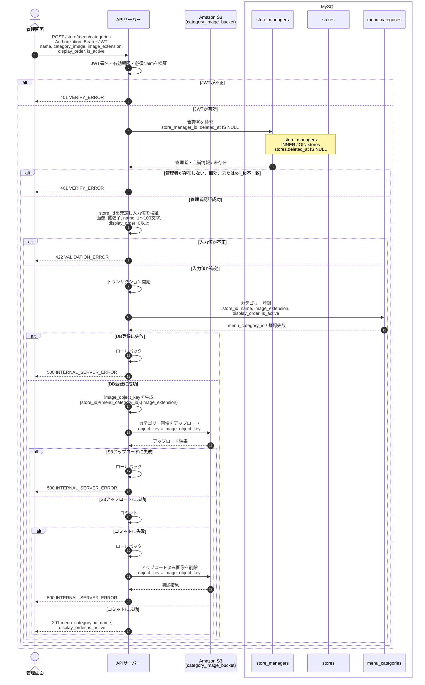
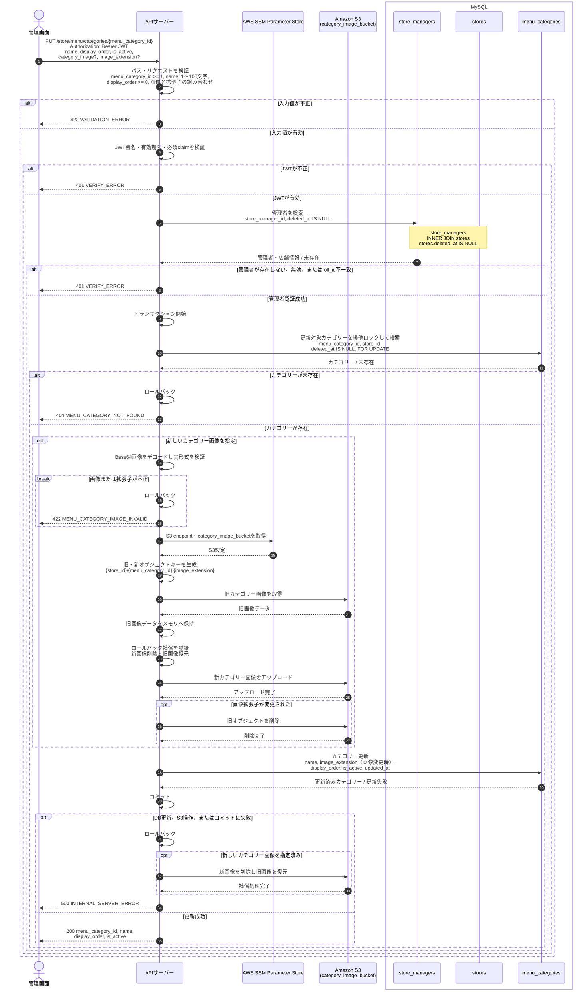
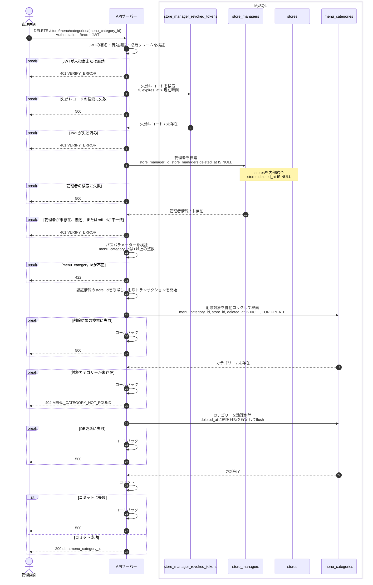
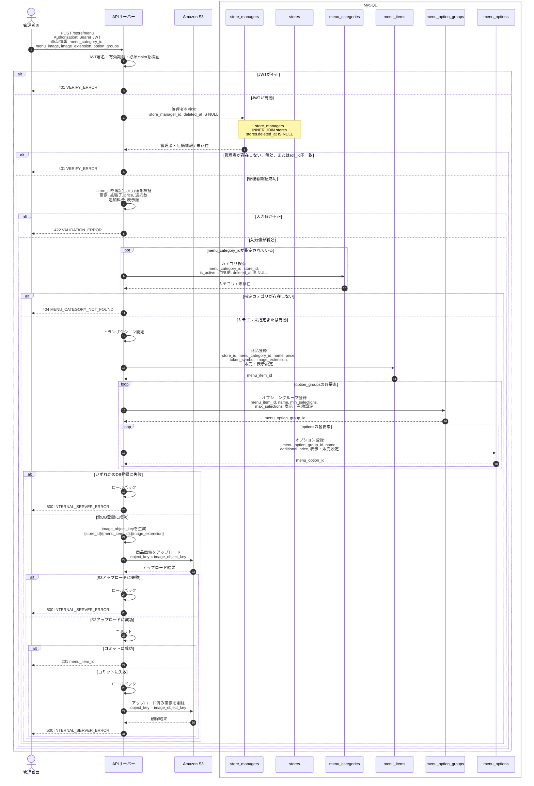
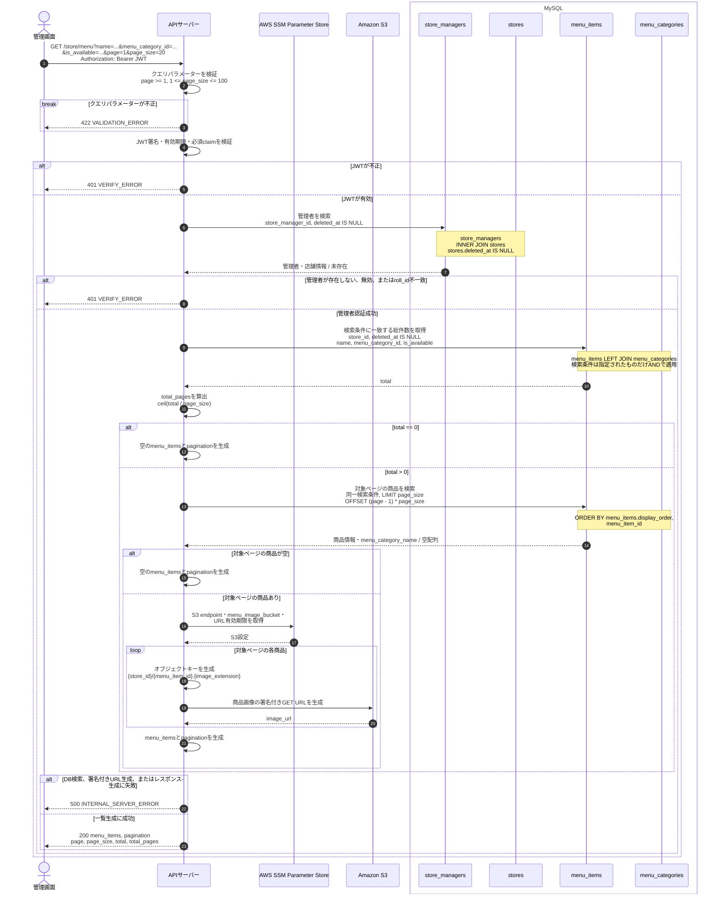
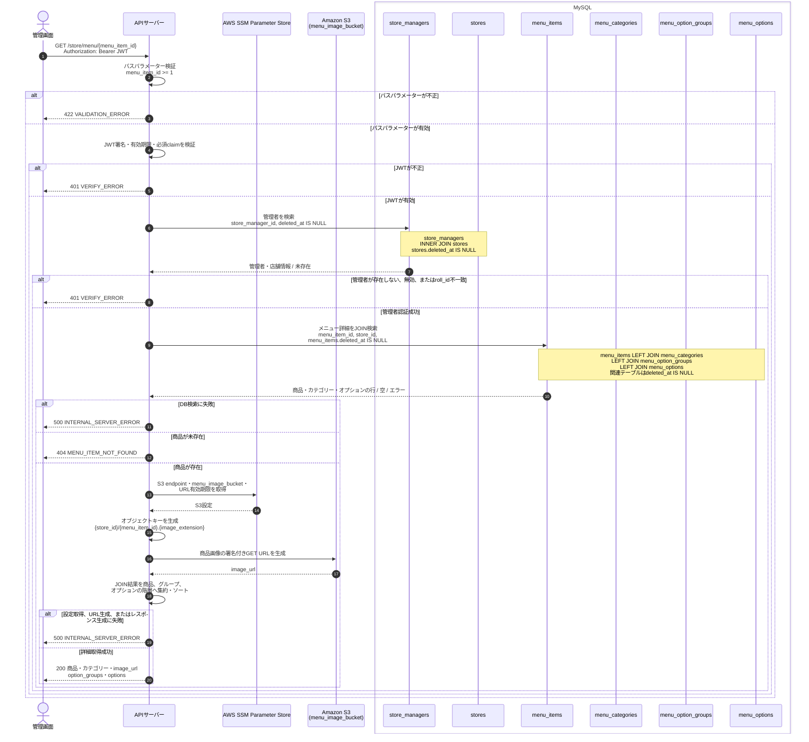
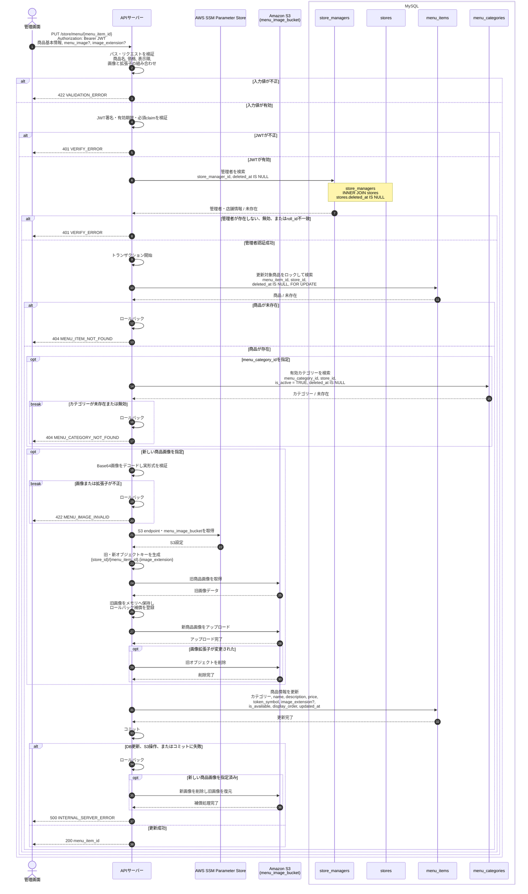
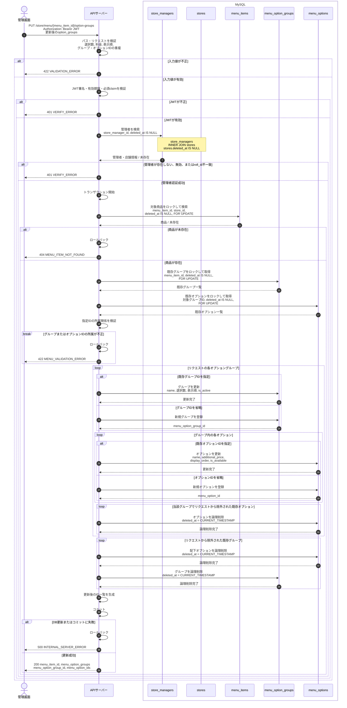

# メニュー管理 API

## 前提

- 店舗管理者のJWTアクセストークンで認証し、対象の `store_id` はトークンに紐づく管理者情報から取得する。リクエストでは `store_id` を受け取らない。
- カテゴリー取得APIは、対象店舗に属する未削除カテゴリーを `name` の部分一致と `is_active` の完全一致で検索し、`display_order`、`menu_category_id` の昇順で返す。`is_active` の未指定時は `true` とする。
- カテゴリー取得APIの `page` は1以上、`page_size` は指定する場合1〜100とする。`page_size` 未指定時はページングせず全カテゴリーを取得し、`pagination.page = 1`、`page_size = null`、`total_pages = 1`（0件の場合は0）を返す。
- カテゴリー画像は `category_image_bucket` の `{store_id}/{menu_category_id}.{image_extension}` から署名付きURLを生成し、`image_url` として返す。URLの有効期限は商品画像と同じ設定値を使用する。
- 1回のリクエストで商品、オプショングループ、オプションを登録する。
- `menu_category_id` は任意とし、指定された場合は同じ店舗に属する有効なカテゴリであることを確認する。
- 商品画像は `menu_image` と `image_extension` で受け取り、本API内でS3へアップロードする。
- `menu_items` には `image_extension` を登録し、S3のオブジェクトキーは `{store_id}/{menu_item_id}.{image_extension}` の形式で生成する。
- 商品、オプショングループ、オプションを同一トランザクション内ですべて登録した後、商品画像をS3へアップロードする。
- S3アップロード成功後にDBトランザクションをコミットする。
- S3アップロード後にコミットが失敗した場合は、アップロード済み画像をS3から削除する。

## カテゴリー取得 API

| 項目 | 内容 |
| --- | --- |
| Method | `GET` |
| Path | `/store/menu/categories` |
| Authentication | `Authorization: Bearer <JWT>` |
| Request | Query: `name`（任意）、`is_active`（既定値true）、`page`（既定値1）、`page_size`（任意、1〜100、未指定時は全件取得） |
| Response | 検索条件に一致するカテゴリー一覧と `pagination`。各カテゴリーに画像の署名付きURLと有効状態を含む |

成功レスポンス例:

```json
{
  "menu_categories": [
    {
      "menu_category_id": 1,
      "name": "ハンバーガー",
      "image_url": "https://example.com/categories/101/1.jpeg?signature=...",
      "display_order": 1,
      "is_active": true
    },
    {
      "menu_category_id": 2,
      "name": "ドリンク",
      "image_url": "https://example.com/categories/101/2.jpeg?signature=...",
      "display_order": 2,
      "is_active": true
    }
  ],
  "pagination": {
    "page": 1,
    "page_size": null,
    "total": 2,
    "total_pages": 1
  }
}
```

| ステータス | 条件 |
| --- | --- |
| `200` | カテゴリー取得成功。該当データがない場合は空配列を返す |
| `401` | JWTが未指定、不正、期限切れ、または管理者が無効 |
| `422` | `name`、`page`、`page_size`、またはその他の検索条件が不正 |
| `500` | DB検索、署名付きURL生成、またはレスポンス生成に失敗 |

### シーケンス図



## カテゴリー詳細取得 API

### 前提

- 店舗管理者をJWTアクセストークンで認証し、対象の `store_id` はトークンに紐づく管理者情報から取得する。リクエストでは `store_id` を受け取らない。
- `menu_category_id` と認証済み管理者の `store_id` が一致し、かつ未削除のカテゴリーを取得する。管理画面で無効カテゴリーを確認できるよう、`is_active` は検索条件に含めない。
- 対象カテゴリーが存在しない、別店舗に属する、または削除済みの場合は、いずれも `404` を返す。
- カテゴリー画像は `category_image_bucket` の `{store_id}/{menu_category_id}.{image_extension}` から署名付きURLを生成し、`image_url` として返す。

| 項目 | 内容 |
| --- | --- |
| Method | `GET` |
| Path | `/store/menu/categories/{menu_category_id}` |
| Authentication | `Authorization: Bearer <JWT>` |
| Request | Path: `menu_category_id`（1以上） |
| Response | 指定したカテゴリーのID、カテゴリー名、画像の署名付きURL、表示順、有効状態 |

成功レスポンス例:

```json
{
  "menu_category_id": 1,
  "name": "ハンバーガー",
  "image_url": "https://example.com/categories/101/1.jpeg?signature=...",
  "display_order": 1,
  "is_active": true
}
```

| ステータス | 条件 |
| --- | --- |
| `200` | カテゴリー詳細取得成功 |
| `401` | JWTが未指定、不正、期限切れ、または管理者が無効 |
| `404` | 指定カテゴリーが認証店舗に存在しない、別店舗に属する、または削除済み |
| `422` | `menu_category_id` が1未満、または整数ではない |
| `500` | DB検索、署名付きURL生成、またはレスポンス生成に失敗 |

### シーケンス図



## カテゴリー登録 API

### 前提

- カテゴリー画像は `category_image` と `image_extension` で受け取り、本API内でS3の `category_image_bucket` へアップロードする。
- `menu_categories` には `image_extension` を登録する。
- `category_image_bucket` 内のS3オブジェクトキーは `{store_id}/{menu_category_id}.{image_extension}` とする。
- S3アップロード成功後にDBトランザクションをコミットする。
- S3アップロード後にコミットが失敗した場合は、アップロード済み画像をS3から削除する。

| 項目 | 内容 |
| --- | --- |
| Method | `POST` |
| Path | `/store/menu/categories` |
| Authentication | `Authorization: Bearer <JWT>` |
| Request | カテゴリー名、`category_image`、`image_extension`、`display_order`、`is_active` |
| Response | 登録したカテゴリーのID、カテゴリー名、表示順、有効フラグ |

リクエスト例:

```json
{
  "name": "ハンバーガー",
  "category_image": "base64-encoded-image",
  "image_extension": "jpeg",
  "display_order": 1,
  "is_active": true
}
```

成功レスポンス例:

```json
{
  "menu_category_id": 1,
  "name": "ハンバーガー",
  "display_order": 1,
  "is_active": true
}
```

| ステータス | 条件 |
| --- | --- |
| `201` | カテゴリー登録成功 |
| `401` | JWTが未指定、不正、期限切れ、または管理者が無効 |
| `422` | カテゴリー画像、拡張子、カテゴリー名、表示順、または有効フラグの入力値が不正 |
| `500` | S3アップロードまたはDB登録に失敗し、DBトランザクションをロールバック |

### シーケンス図



### 入力検証

- `name` は空文字を許可せず、1〜100文字とする。
- `category_image` はBase64形式の画像データとする。
- `image_extension` は許可された画像拡張子とし、`category_image` の実形式と一致させる。
- `display_order` は0以上の整数とし、未指定時は `0` とする。
- `is_active` は真偽値とし、未指定時は `true` とする。

## カテゴリー更新 API

### 前提

- 店舗管理者をJWTアクセストークンで認証し、対象の `store_id` はトークンに紐づく管理者情報から取得する。リクエストでは `store_id` を受け取らない。
- `menu_category_id` と認証済み管理者の `store_id` が一致し、かつ未削除のカテゴリーだけを更新できる。無効カテゴリーも更新対象とする。
- カテゴリー名、表示順、有効状態は更新リクエストで必須とする。画像を変更しない場合は、既存の画像と拡張子を維持する。
- `category_image` と `image_extension` は両方指定または両方省略とし、片方だけの指定は許可しない。
- 画像を変更する場合は、旧画像を取得してAPIサーバーのメモリへ保持してから新画像をアップロードする。拡張子が変わる場合は、アップロード後に旧オブジェクトを削除する。
- DB更新、S3操作、またはコミットに失敗した場合はDBをロールバックし、新画像を削除してメモリに保持した旧画像を復元する。

| 項目 | 内容 |
| --- | --- |
| Method | `PUT` |
| Path | `/store/menu/categories/{menu_category_id}` |
| Authentication | `Authorization: Bearer <JWT>` |
| Request | カテゴリー名、`display_order`、`is_active`、任意の `category_image` と `image_extension` |
| Response | 更新したカテゴリーのID、カテゴリー名、表示順、有効状態 |

リクエスト例:

```json
{
  "name": "ハンバーガー・サンドイッチ",
  "category_image": "base64-encoded-image",
  "image_extension": "png",
  "display_order": 2,
  "is_active": true
}
```

画像を変更しない場合は、`category_image` と `image_extension` を省略する。

成功レスポンス例:

```json
{
  "menu_category_id": 1,
  "name": "ハンバーガー・サンドイッチ",
  "display_order": 2,
  "is_active": true
}
```

| ステータス | 条件 |
| --- | --- |
| `200` | カテゴリー更新成功 |
| `401` | JWTが未指定、不正、期限切れ、または管理者が無効 |
| `404` | 指定カテゴリーが認証店舗に存在しない、別店舗に属する、または削除済み |
| `422` | パスパラメーター、カテゴリー情報、画像データ、または画像拡張子が不正 |
| `500` | DB更新、S3操作、コミット、またはレスポンス生成に失敗 |

### シーケンス図



### 入力検証

- `menu_category_id` は1以上の整数とする。
- `name` は空文字を許可せず、1〜100文字とする。
- `display_order` は0以上の整数とする。
- `is_active` は真偽値とする。
- `category_image` と `image_extension` は両方指定または両方省略とする。
- `category_image` は指定時のみBase64形式の画像データとして検証する。
- `image_extension` は許可された画像拡張子とし、`category_image` の実形式と一致させる。

## カテゴリー削除 API

### 前提

- 店舗管理者をJWTアクセストークンで認証し、認証情報の `store_id` を削除対象の検索に使う。
- 既存のデバイス削除APIに合わせ、同じ店舗の未削除カテゴリーを排他ロックして取得し、`deleted_at` を設定して論理削除する。無効カテゴリーも対象とする。
- 商品とカテゴリーの紐づけ、およびS3のカテゴリー画像を保持する。既存の商品一覧・詳細では、削除済みカテゴリーの `menu_category_id` と `menu_category_name` は `null` になる。

| 項目 | 内容 |
| --- | --- |
| Method | `DELETE` |
| Path | `/store/menu/categories/{menu_category_id}` |
| Authentication | `Authorization: Bearer <JWT>` |
| Request | 1以上の整数の `menu_category_id` をパスで指定。リクエストボディなし |
| Response | 共通レスポンスの `data.menu_category_id` に削除したカテゴリーIDを返す |

| ステータス | 条件 |
| --- | --- |
| `200` | カテゴリー削除成功 |
| `401` | JWTが未指定、不正、期限切れ、失効済み、または店舗管理者の認証に失敗 |
| `404` | カテゴリーが存在しない、別店舗に属する、または削除済み |
| `422` | `menu_category_id` が不正 |
| `500` | DBの参照、更新、またはコミットに失敗 |

### シーケンス図



### 実装メモ

- `authenticate_store_manager` と `mysql_transaction` を再利用する。カテゴリー更新と削除は `StoreMenuCategoryRepository.get_menu_category_detail` で同じ行を排他ロックする。対象がない場合は、既存の `MenuCategoryNotFoundException` を `404` に変換する。
- `StoreMenuCategoryRepository.soft_delete_menu_category` が排他ロック済みカテゴリーの `deleted_at` を設定し、現在のトランザクションでDBに反映する。
- 現行の商品一覧の `menu_category_id` フィルターは商品テーブルの外部キーで絞り込むため、削除済みカテゴリーIDを直接指定すると、紐づいている商品が引き続き検索結果に含まれる。

## メニュー登録 API

| 項目 | 内容 |
| --- | --- |
| Method | `POST` |
| Path | `/store/menu` |
| Authentication | `Authorization: Bearer <JWT>` |
| Request | 商品情報、`menu_category_id`、`menu_image`、`image_extension`、`option_groups` |
| Response | 登録した商品ID |

リクエスト例:

```json
{
  "menu_category_id": 1,
  "name": "チーズバーガー",
  "description": "チェダーチーズ入り",
  "price": "800.000000",
  "token_symbol": "JPYC",
  "menu_image": "base64-encoded-image",
  "image_extension": "jpeg",
  "is_available": true,
  "display_order": 1,
  "option_groups": [
    {
      "name": "サイズ",
      "min_selections": 1,
      "max_selections": 1,
      "display_order": 1,
      "is_active": true,
      "options": [
        {
          "name": "通常",
          "additional_price": "0.000000",
          "display_order": 1,
          "is_available": true
        },
        {
          "name": "大盛り",
          "additional_price": "100.000000",
          "display_order": 2,
          "is_available": true
        }
      ]
    }
  ]
}
```

成功レスポンス例:

```json
{
  "menu_item_id": 10
}
```

| ステータス | 条件 |
| --- | --- |
| `201` | メニュー登録成功 |
| `401` | JWTが未指定、不正、期限切れ、または管理者が無効 |
| `404` | 指定カテゴリが登録先店舗に存在しない、無効、または削除済み |
| `422` | 商品画像、拡張子、商品、オプショングループ、またはオプションの入力値が不正 |
| `500` | S3アップロードまたはDB登録に失敗し、DBトランザクションをロールバック |

### シーケンス図



## 入力検証

- `price` は0以上とする。
- `min_selections <= max_selections` かつ `max_selections > 0` とする。
- `additional_price` は0以上とする。
- `menu_image` はBase64形式の画像データとする。
- `image_extension` は許可された画像拡張子とする。
- 指定された `menu_category_id` は、認証済み管理者の `store_id` と一致するカテゴリに限る。

## メニュー一覧取得 API

### 前提

- 店舗管理者のJWTアクセストークンで認証し、対象の `store_id` はトークンに紐づく管理者情報から取得する。リクエストでは `store_id` を受け取らない。
- 管理画面で販売状態を確認できるように、対象店舗の未削除の商品を取得する。`is_available` が `FALSE` の商品も返す。
- `menu_categories` をLEFT JOINし、未削除のカテゴリー名を `menu_category_name` として返す。商品にカテゴリーが紐づかない場合は `menu_category_id` と `menu_category_name` を `null` とする。
- 一覧取得では `menu_option_groups` と `menu_options` を参照せず、オプショングループとオプションは商品詳細APIで取得する。
- 商品は `display_order`、`menu_item_id` の昇順で返す。該当する商品がない場合は空配列を返す。
- 商品画像は `{store_id}/{menu_item_id}.{image_extension}` 形式のオブジェクトキーから、有効期限付きの署名付きURLを生成し、`image_url` として返す。URLの有効期限は設定値で管理する。
- `name` は商品名の部分一致、`menu_category_id` はカテゴリーIDの完全一致、`is_available` は公開状態の完全一致で検索する。複数条件はANDで組み合わせる。
- `page` は1以上、`page_size` は1〜100とし、未指定時はそれぞれ `1`、`20` を使用する。
- 検索条件に一致する総件数を取得した後、`OFFSET = (page - 1) * page_size` と `LIMIT = page_size` を適用して対象ページの商品を取得する。

| 項目 | 内容 |
| --- | --- |
| Method | `GET` |
| Path | `/store/menu` |
| Authentication | `Authorization: Bearer <JWT>` |
| Request | Query: `name`（任意）、`menu_category_id`（任意）、`is_available`（任意）、`page`（既定値1）、`page_size`（既定値20、最大100） |
| Response | 対象ページのメニュー商品一覧と `pagination`。各商品にカテゴリー名と画像URLを含み、オプショングループとオプションは含まない |

成功レスポンス例:

```json
{
  "menu_items": [
    {
      "menu_item_id": 10,
      "menu_category_id": 1,
      "menu_category_name": "ハンバーガー",
      "name": "チーズバーガー",
      "description": "チェダーチーズ入り",
      "price": "800.000000",
      "token_symbol": "JPYC",
      "image_url": "https://example.com/menus/101/10.jpeg?signature=...",
      "is_available": true,
      "display_order": 1
    }
  ],
  "pagination": {
    "page": 1,
    "page_size": 20,
    "total": 35,
    "total_pages": 2
  }
}
```

| ステータス | 条件 |
| --- | --- |
| `200` | メニュー一覧取得成功。該当データがない場合は空配列を返す |
| `401` | JWTが未指定、不正、期限切れ、または管理者が無効 |
| `422` | `page`、`page_size`、その他の検索条件が不正 |
| `500` | DB検索、署名付きURL生成、またはレスポンス生成に失敗 |

### シーケンス図



## メニュー詳細取得 API

### 前提

- 現行ソースにはメニュー詳細取得処理が未実装のため、既存のメニュー一覧取得、メニュー登録、カテゴリー詳細取得の実装方針を基に定義する。
- 店舗管理者のJWTアクセストークンで認証し、対象の `store_id` はトークンに紐づく管理者情報から取得する。リクエストでは `store_id` を受け取らない。
- `menu_item_id` と認証済み管理者の `store_id` が一致し、かつ未削除の商品を取得する。管理画面で販売状態を確認できるよう、`is_available` は検索条件に含めない。
- 対象商品が存在しない、別店舗に属する、または削除済みの場合は、いずれも `404` を返す。
- `menu_categories`、`menu_option_groups`、`menu_options` はLEFT JOINで取得する。カテゴリーが未設定または削除済みの場合、`menu_category_id` と `menu_category_name` は `null` とする。
- 管理画面で設定内容を確認できるよう、未削除のオプショングループとオプションは、`is_active` または `is_available` の値にかかわらず返す。
- オプショングループは `display_order`、`menu_option_group_id` の昇順、各オプションは `display_order`、`menu_option_id` の昇順で返す。該当データがない場合は空配列を返す。
- 商品画像は `{store_id}/{menu_item_id}.{image_extension}` 形式のオブジェクトキーから、有効期限付きの署名付きURLを生成し、`image_url` として返す。URLの有効期限は設定値で管理する。

| 項目 | 内容 |
| --- | --- |
| Method | `GET` |
| Path | `/store/menu/{menu_item_id}` |
| Authentication | `Authorization: Bearer <JWT>` |
| Request | Path: `menu_item_id`（1以上） |
| Response | 商品、カテゴリー、画像URL、オプショングループ、オプションを含むメニュー詳細 |

成功レスポンス例:

```json
{
  "menu_item_id": 10,
  "menu_category_id": 1,
  "menu_category_name": "ハンバーガー",
  "name": "チーズバーガー",
  "description": "チェダーチーズ入り",
  "price": "800.000000",
  "token_symbol": "JPYC",
  "image_url": "https://example.com/menus/101/10.jpeg?signature=...",
  "is_available": true,
  "display_order": 1,
  "option_groups": [
    {
      "menu_option_group_id": 20,
      "name": "サイズ",
      "min_selections": 1,
      "max_selections": 1,
      "display_order": 1,
      "is_active": true,
      "options": [
        {
          "menu_option_id": 30,
          "name": "大盛り",
          "additional_price": "100.000000",
          "display_order": 1,
          "is_available": true
        }
      ]
    }
  ]
}
```

| ステータス | 条件 |
| --- | --- |
| `200` | メニュー詳細取得成功 |
| `401` | JWTが未指定、不正、期限切れ、または管理者が無効 |
| `404` | 指定商品が認証店舗に存在しない、別店舗に属する、または削除済み |
| `422` | `menu_item_id` が1未満、または整数ではない |
| `500` | DB検索、署名付きURL生成、またはレスポンス生成に失敗 |

### シーケンス図



### 実装メモ

- `MENU_ITEM_NOT_FOUND` は本APIで追加するエラー識別子とし、対応する例外とメッセージを定義する。
- LEFT JOINする関連テーブルの `deleted_at IS NULL` はJOIN条件に含め、カテゴリーやオプションがない商品も取得できるようにする。

## メニュー基本情報更新 API

### 前提

- 現行ソースにはメニュー更新処理が未実装のため、メニュー登録、メニュー詳細取得、カテゴリー更新の実装方針を基に定義する。
- 店舗管理者のJWTアクセストークンで認証し、対象の `store_id` はトークンに紐づく管理者情報から取得する。リクエストでは `store_id` を受け取らない。
- `menu_item_id` と認証済み管理者の `store_id` が一致し、かつ未削除の商品だけを更新できる。販売停止中の商品も更新対象とする。
- `menu_category_id` は `null` を許可する。指定する場合は認証店舗に属する未削除かつ有効なカテゴリーに限定する。
- `menu_image` と `image_extension` は両方指定または両方省略とし、省略時は既存画像を維持する。
- 画像を変更する場合は旧画像をメモリへ保持してから新画像をアップロードする。DB更新、S3操作、またはコミットに失敗した場合はDBをロールバックし、新画像を削除して旧画像を復元する。
- 本APIは `menu_option_groups` と `menu_options` を更新しない。オプション構成は専用APIで更新する。
- 同一商品への同時更新による上書きを防ぐため、商品をトランザクション内でロックして更新する。

| 項目 | 内容 |
| --- | --- |
| Method | `PUT` |
| Path | `/store/menu/{menu_item_id}` |
| Authentication | `Authorization: Bearer <JWT>` |
| Request | 商品基本情報、任意の `menu_image` と `image_extension` |
| Response | 更新した商品ID |

リクエスト例:

```json
{
  "menu_category_id": 1,
  "name": "ダブルチーズバーガー",
  "description": "チーズを2枚に変更",
  "price": "950.000000",
  "token_symbol": "JPYC",
  "menu_image": "base64-encoded-image",
  "image_extension": "png",
  "is_available": true,
  "display_order": 1
}
```

画像を変更しない場合は、`menu_image` と `image_extension` を省略する。

成功レスポンス例:

```json
{
  "menu_item_id": 10
}
```

| ステータス | 条件 |
| --- | --- |
| `200` | メニュー基本情報更新成功 |
| `401` | JWTが未指定、不正、期限切れ、または管理者が無効 |
| `404` | 指定商品または指定カテゴリーが認証店舗に存在しない、別店舗に属する、削除済み、もしくはカテゴリーが無効 |
| `422` | パス、商品情報、画像データ、または画像拡張子が不正 |
| `500` | DB更新、S3操作、コミット、補償処理、またはレスポンス生成に失敗 |

### シーケンス図



### 入力検証

- `menu_item_id` は1以上の整数とする。
- `name` は空文字を許可せず、1〜255文字とする。
- `description` は `null` を許可する。
- `price` は0以上、小数点以下6桁までとする。
- `token_symbol` は1〜20文字とする。
- `display_order` は0以上の整数とする。
- `menu_image` と `image_extension` は両方指定または両方省略とする。指定時はBase64画像の実形式と拡張子を一致させる。

### 実装メモ

- オプション構成は本APIのトランザクションに含めず、専用APIで完全同期する。
- 現行テーブルにバージョン列がないため、本案では商品行に `SELECT ... FOR UPDATE` を使用する。
- 実装時はメニュー基本情報更新用リクエスト・レスポンスモデル、商品行のロック付き取得・更新処理、S3画像復元処理、各層のテストを追加する。

## メニューオプション構成更新 API

### 前提

- 店舗管理者のJWTアクセストークンで認証し、対象の `store_id` はトークンに紐づく管理者情報から取得する。リクエストでは `store_id` を受け取らない。
- `menu_item_id` と認証済み管理者の `store_id` が一致し、かつ未削除の商品に対してオプション構成を更新する。販売停止中の商品も更新対象とする。
- `option_groups` は更新後の完全な状態として扱う。既存IDを指定した要素は更新、IDを省略した要素は追加、既存データのうちリクエストに含まれない要素は論理削除する。
- オプショングループを論理削除する場合、そのグループに属する未削除オプションも同時に論理削除する。論理削除済みIDの再利用は許可しない。
- 既存グループIDは更新対象商品、既存オプションIDはリクエスト内の親グループに属することを検証する。他の商品やグループに属するIDは更新しない。
- 同一商品への同時更新による上書きを防ぐため、商品、オプショングループ、オプションをトランザクション内でロックして更新する。
- 本APIは `menu_items` の商品基本情報とS3の商品画像を更新しない。

| 項目 | 内容 |
| --- | --- |
| Method | `PUT` |
| Path | `/store/menu/{menu_item_id}/option-groups` |
| Authentication | `Authorization: Bearer <JWT>` |
| Request | 更新後の完全な `option_groups`。空配列の場合は全オプション構成を論理削除 |
| Response | 商品IDと、更新後のオプショングループID・オプションID |

リクエスト例:

```json
{
  "option_groups": [
    {
      "menu_option_group_id": 20,
      "name": "サイズ",
      "min_selections": 1,
      "max_selections": 1,
      "display_order": 1,
      "is_active": true,
      "options": [
        {
          "menu_option_id": 30,
          "name": "通常",
          "additional_price": "0.000000",
          "display_order": 1,
          "is_available": true
        },
        {
          "name": "特大",
          "additional_price": "200.000000",
          "display_order": 2,
          "is_available": true
        }
      ]
    },
    {
      "name": "トッピング",
      "min_selections": 0,
      "max_selections": 2,
      "display_order": 2,
      "is_active": true,
      "options": []
    }
  ]
}
```

成功レスポンス例:

```json
{
  "menu_item_id": 10,
  "menu_option_groups": [
    {
      "menu_option_group_id": 20,
      "menu_option_ids": [30, 32]
    },
    {
      "menu_option_group_id": 22,
      "menu_option_ids": []
    }
  ]
}
```

| ステータス | 条件 |
| --- | --- |
| `200` | メニューオプション構成更新成功 |
| `401` | JWTが未指定、不正、期限切れ、または管理者が無効 |
| `404` | 指定商品が認証店舗に存在しない、別店舗に属する、または削除済み |
| `422` | パス、選択数、IDの重複、またはグループ・オプションの所属関係が不正 |
| `500` | DB更新、コミット、またはレスポンス生成に失敗 |

### シーケンス図



### 入力検証

- `menu_item_id` は1以上の整数とする。
- `option_groups` は必須の配列とし、空配列を許可する。
- グループ名とオプション名は空文字を許可せず、1〜100文字とする。
- `additional_price` は0以上、小数点以下6桁までとする。
- `display_order`、`min_selections` は0以上、`max_selections` は1以上とし、`min_selections <= max_selections` を満たすこと。
- 同一リクエスト内で `menu_option_group_id` と `menu_option_id` を重複指定しない。
- 既存グループIDは更新対象商品、既存オプションIDはリクエスト内の親グループに属すること。

### 実装メモ

- メニュー基本情報更新とオプション構成更新は別トランザクションとなる。管理画面が両APIを連続実行する場合は、片方だけ成功した状態を許容し、失敗したAPIだけ再試行できるようにする。
- 現行テーブルにバージョン列がないため、本案では商品と関連オプション行に `SELECT ... FOR UPDATE` を使用する。
- 実装時はオプション構成更新用リクエストモデル、Repositoryのロック付き取得・差分同期・論理削除処理、各層のテストを追加する。
