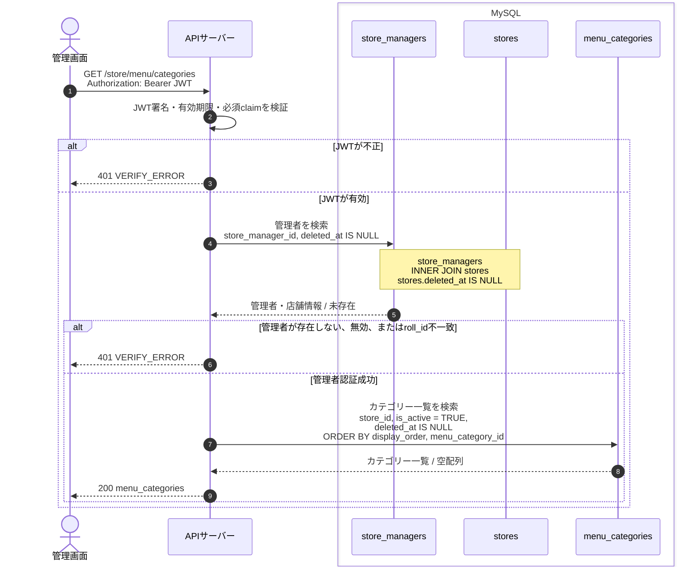
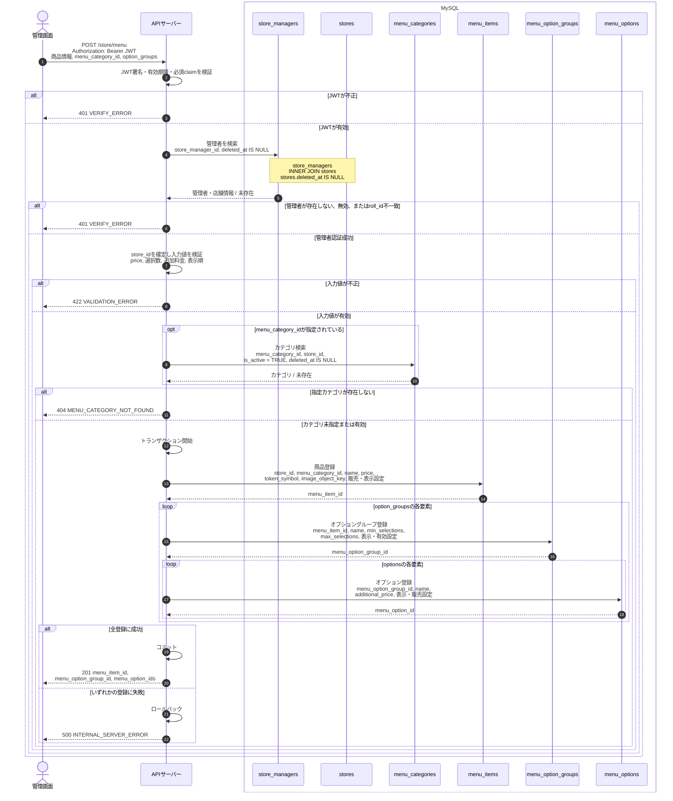

# メニュー登録 API

## 前提

- 店舗管理者のJWTアクセストークンで認証し、対象の `store_id` はトークンに紐づく管理者情報から取得する。リクエストでは `store_id` を受け取らない。
- カテゴリー取得APIは、対象店舗に属する有効かつ未削除のカテゴリーを `display_order`、`menu_category_id` の昇順で返す。該当するカテゴリーがない場合は空配列を返す。
- 1回のリクエストで商品、オプショングループ、オプションを登録する。
- `menu_category_id` は任意とし、指定された場合は同じ店舗に属する有効なカテゴリであることを確認する。
- 商品画像のアップロード処理は本APIの対象外とし、アップロード済み画像の `image_object_key` を受け取る。
- 商品、オプショングループ、オプションは同一トランザクションで登録し、途中で失敗した場合はすべてロールバックする。

## カテゴリー取得 API

| 項目 | 内容 |
| --- | --- |
| Method | `GET` |
| Path | `/store/menu/categories` |
| Authentication | `Authorization: Bearer <JWT>` |
| Request | なし |
| Response | 対象店舗の有効なカテゴリー一覧 |

成功レスポンス例:

```json
{
  "menu_categories": [
    {
      "menu_category_id": 1,
      "name": "ハンバーガー",
      "display_order": 1
    },
    {
      "menu_category_id": 2,
      "name": "ドリンク",
      "display_order": 2
    }
  ]
}
```

| ステータス | 条件 |
| --- | --- |
| `200` | カテゴリー取得成功。該当データがない場合は空配列を返す |
| `401` | JWTが未指定、不正、期限切れ、または管理者が無効 |

### シーケンス図



## メニュー登録 API

| 項目 | 内容 |
| --- | --- |
| Method | `POST` |
| Path | `/store/menu` |
| Authentication | `Authorization: Bearer <JWT>` |
| Request | 商品情報、`menu_category_id`、`option_groups` |
| Response | 登録した商品、オプショングループ、オプションのID |

リクエスト例:

```json
{
  "menu_category_id": 1,
  "name": "チーズバーガー",
  "description": "チェダーチーズ入り",
  "price": "800.000000",
  "token_symbol": "JPYC",
  "image_object_key": "menus/101/cheese-burger.jpg",
  "is_available": true,
  "display_order": 1,
  "option_groups": [
    {
      "name": "サイズ",
      "min_selections": 1,
      "max_selections": 1,
      "display_order": 1,
      "is_active": true,
      "options": [
        {
          "name": "通常",
          "additional_price": "0.000000",
          "display_order": 1,
          "is_available": true
        },
        {
          "name": "大盛り",
          "additional_price": "100.000000",
          "display_order": 2,
          "is_available": true
        }
      ]
    }
  ]
}
```

成功レスポンス例:

```json
{
  "menu_item_id": 10,
  "menu_option_groups": [
    {
      "menu_option_group_id": 20,
      "menu_option_ids": [30, 31]
    }
  ]
}
```

| ステータス | 条件 |
| --- | --- |
| `201` | メニュー登録成功 |
| `401` | JWTが未指定、不正、期限切れ、または管理者が無効 |
| `404` | 指定カテゴリが登録先店舗に存在しない、無効、または削除済み |
| `422` | 商品、オプショングループ、またはオプションの入力値が不正 |
| `500` | DB登録に失敗し、トランザクションをロールバック |

### シーケンス図



## 入力検証

- `price` は0以上とする。
- `min_selections <= max_selections` かつ `max_selections > 0` とする。
- `additional_price` は0以上とする。
- 指定された `menu_category_id` は、認証済み管理者の `store_id` と一致するカテゴリに限る。
