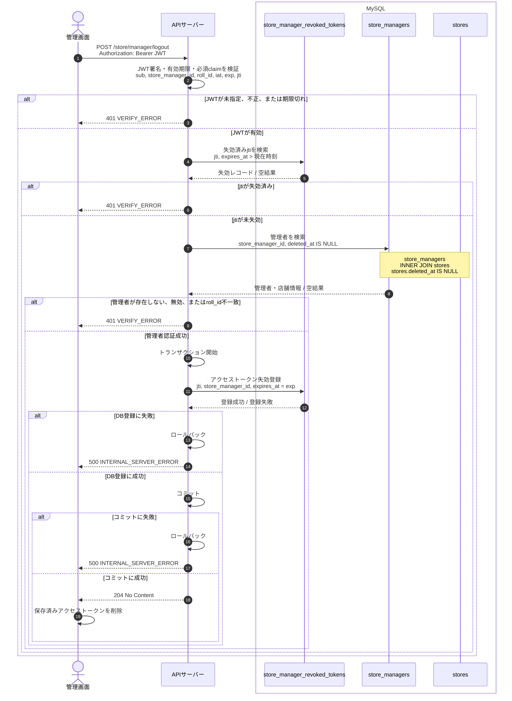

# 管理者ログアウト API

## 前提

- 店舗管理者はログインAPIで発行されたJWTアクセストークンを `Authorization: Bearer <JWT>` で送信する。
- JWTは現行実装と同様にHS256で検証し、`sub`、`store_manager_id`、`roll_id`、`iat`、`exp`、`jti` を必須claimとする。
- ログアウト後にアクセストークンを即時利用不可にするため、JWTの `jti` を `store_manager_revoked_tokens` に保存する。
- `store_manager_revoked_tokens` は新設テーブルとし、少なくとも `jti`（一意）、`store_manager_id`、`expires_at`、`created_at` を保持する。
- 既存の管理者認証（`authenticate_store_manager`）は `store_manager_revoked_tokens` を参照し、失効済みのJWTを `401` で拒否する。
- 失効レコードはJWTの有効期限を過ぎた後に削除できる。日時はUTCで保存・比較する。
- リフレッシュトークンは現行実装に存在しないため、本APIの対象外とする。

## ログアウト API

| 項目 | 内容 |
| --- | --- |
| Method | `POST` |
| Path | `/store/manager/logout` |
| Authentication | `Authorization: Bearer <JWT>` |
| Request | なし |
| Response | なし |

| ステータス | 条件 |
| --- | --- |
| `204` | アクセストークンの失効登録に成功 |
| `401` | JWTが未指定、不正、期限切れ、失効済み、または管理者を認証できない |
| `500` | DB登録またはコミットに失敗 |

## シーケンス図

## セキュリティ要件

- アクセストークン本体はDBやログへ保存せず、失効判定には `jti` のみを使用する。
- `jti` には一意制約を設定し、同一トークンの重複登録を防止する。
- クライアントは `204` を受信した後に、ローカルへ保存したアクセストークンを削除する。
- JWT、Authorizationヘッダー、署名鍵をアプリケーションログへ出力しない。
- 有効期限切れの失効レコードは定期削除し、テーブルの肥大化を防止する。

## DB適用

- APIをデプロイする前に、`store_managers` がある対象DBで[テーブル・削除イベント作成SQL](../../../tools/mysql/001_store_manager_revoked_tokens.sql)を適用する。
- イベントを作成するユーザーには対象DBの `EVENT` 権限と、実行時に失効テーブルの行を削除する権限が必要。MySQLの `event_scheduler` を `ON` にすると、期限切れのレコードを1時間ごとに削除する。
