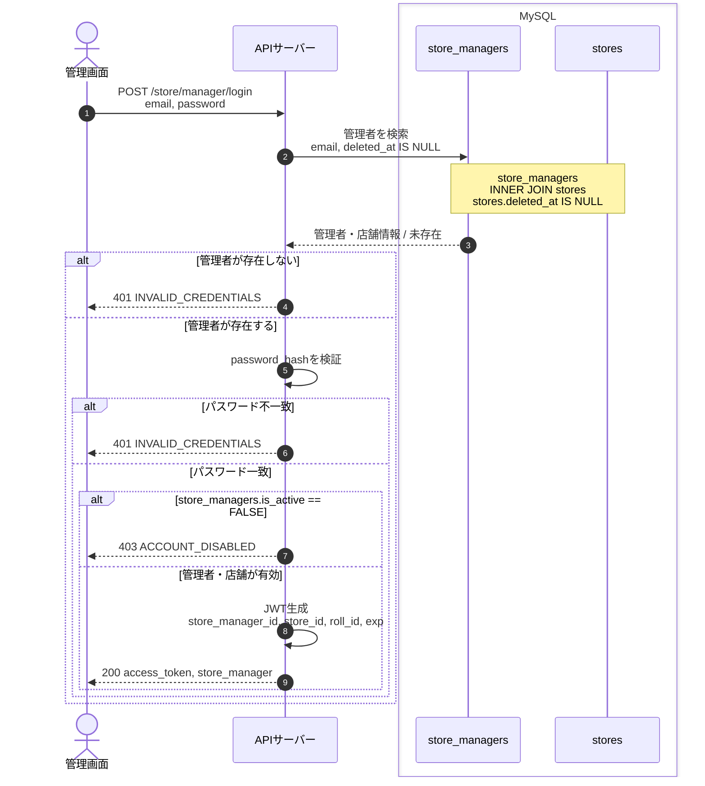

# 管理者ログイン API

## 前提

- メールアドレスとパスワードで認証する。
- パスワードは平文保存せず、`store_managers.password_hash` と照合する。
- 成功時は `store_manager_id`、`store_id`、`roll_id` を含むJWTアクセストークンを返す。
- リフレッシュトークンとログアウトAPIは本書の対象外とする。

## ログイン API

| 項目 | 内容 |
| --- | --- |
| Method | `POST` |
| Path | `/store/manager/login` |
| Request | `email`, `password` |
| Response | `access_token`, `token_type`, `expires_in`, `store_manager` |

リクエスト例:

```json
{
  "email": "manager@example.com",
  "password": "password"
}
```

成功レスポンス例:

```json
{
  "access_token": "eyJ...",
  "token_type": "Bearer",
  "expires_in": 3600,
  "store_manager": {
    "store_manager_id": 1,
    "store_id": 101,
    "name": "店舗管理者",
    "roll_id": 1
  }
}
```

| ステータス | 条件 |
| --- | --- |
| `200` | ログイン成功 |
| `401` | メールアドレスまたはパスワードが不一致 |
| `403` | 管理者または店舗が無効 |
| `422` | 入力形式が不正 |

## シーケンス図



## セキュリティ要件

- パスワード照合にはArgon2idまたはbcryptを使用する。
- メールアドレスの存在有無にかかわらず、認証失敗時は同じ`401`を返す。
- API単位およびメールアドレス単位でレート制限を行う。
- JWT署名鍵をソースコードやDBへ保存しない。
