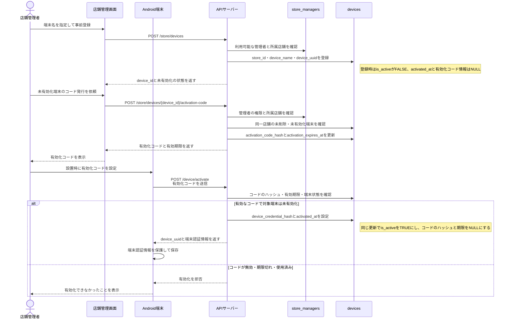
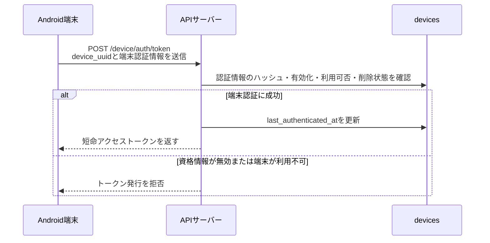
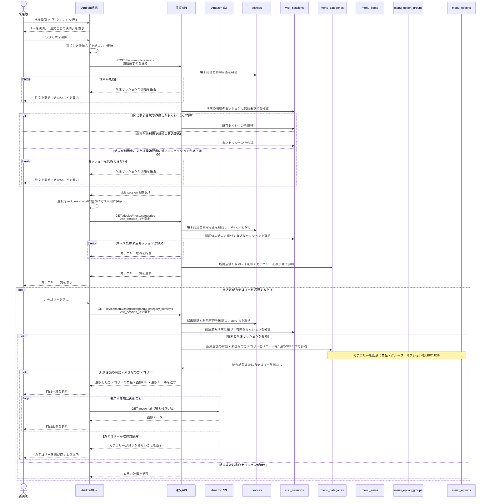
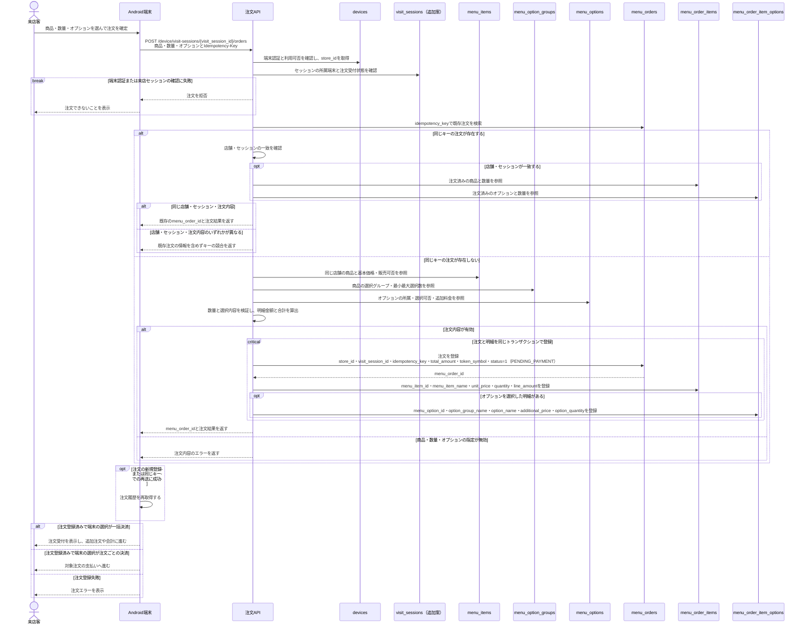
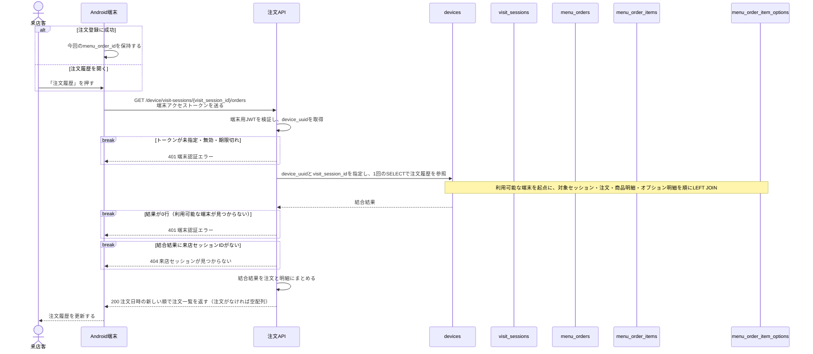
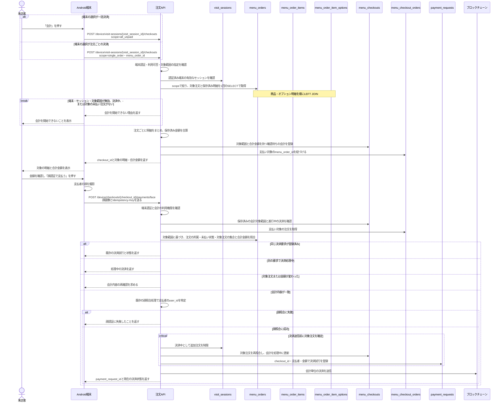
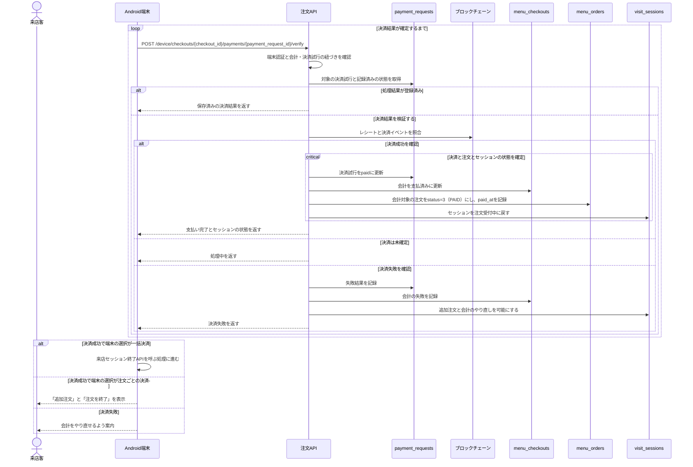
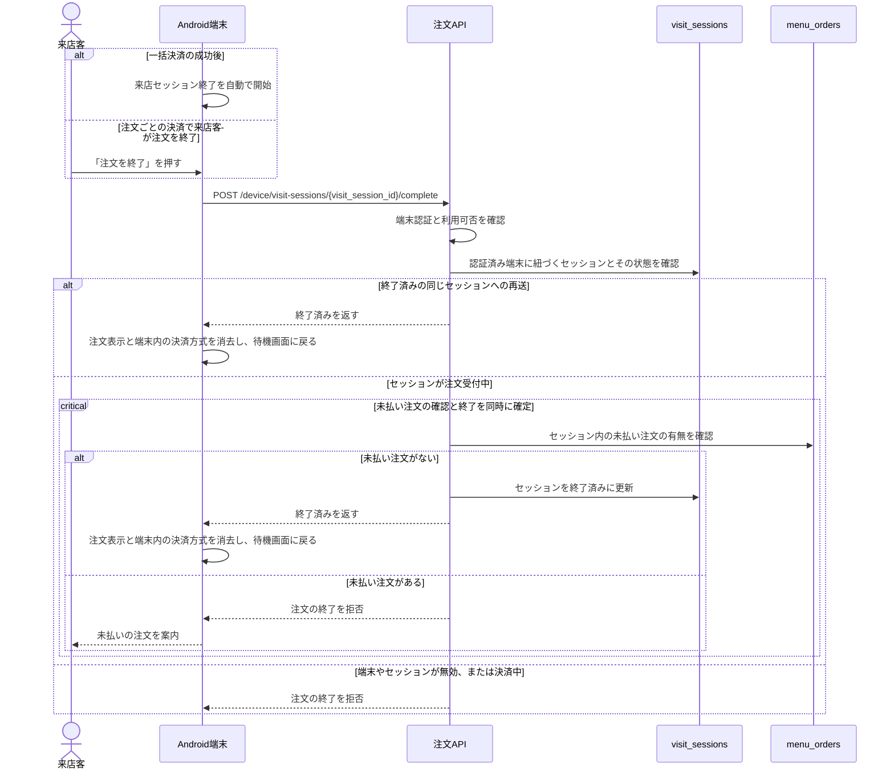
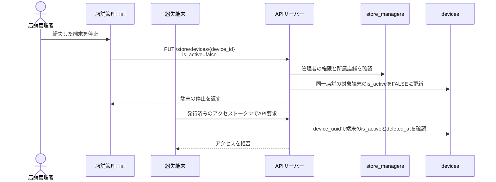

# メニュー注文端末のシーケンス図

来店客が客席に常設された Android 端末で「注文する」を押すと、「一括決済」「注文ごとの決済」の選択画面が表示される。端末が選択を保持して来店セッションを開始し、カテゴリー一覧を表示する。注文・追加注文は同じ来店セッションに記録し、端末が選択したタイミングで顔認証決済を開始する。

注文画面は端末認証で利用できる。ログイン操作やスタッフによる開始操作は不要。店舗は認証済み端末の `devices.store_id` で特定する。 [DB構成](DB構成.md) · [既存の顔認証メニュー注文・決済設計](sequences/決済端末用API/menu_order_payment_sequence.md)

## DB変更案

| 対象 | 変更内容 |
| --- | --- |
| `visit_sessions` | `devices.device_id`、開始要求ID、開始・終了時刻と状態を管理する。端末1台につき同時に有効なセッションを1件とする。 |
| `menu_orders` | `visit_session_id` を追加する。注文時に購入者が未特定の店内端末注文は `user_id = NULL` を許容し、既存の購入者付き注文では購入者IDを引き続き設定する。 |
| `menu_checkouts`・`menu_checkout_orders` | 来店セッション、会計の状態、対象範囲、支払い対象の注文と確定金額を記録する。 |
| `payment_requests` | 1回の決済試行を会計に紐づける `checkout_id` を追加する。顔照合で特定した支払者は `payment_requests.user_id` に記録する。 |

以下の会計・決済フローでは、会計単位の決済に上表の変更案を適用する。既存のDB設計では `payment_requests.menu_order_id` は注文1件への参照。 [DB構成](DB構成.md)

## 1. 端末の事前登録・有効化・認証

### 1.1 事前登録と初回有効化

端末側の初回操作は、店舗管理側で発行された一回限りの有効化コードを設定するところから始まる。有効化コードと端末認証情報はハッシュで保存する。

有効化時はコードの検証と更新を一体で行い、同じコードを同時に送信しても1回だけ有効化する。未有効化端末へのコード再発行時は、新しいハッシュと期限で上書きする。

### 1.2 端末アクセストークンの取得

トークンの有効期限が切れた場合は同じAPIで再取得する。端末向けAPIはリクエストごとに端末の利用可否を確認する。

## 2. 来店セッションの開始と注文

### 2.1 決済方式の選択・来店セッション開始・カテゴリー選択

- 端末は再起動後も、取得したセッションIDに対応する決済方式の選択を端末内から復元する。
- 開始要求を再送する場合は同じ開始要求IDを使う。セッションの作成と有効なセッションの一意性はサーバーで同時に確定する。
- 販売可能な商品がないカテゴリーは空の一覧を返す。
- 注文画面の復帰や端末の再起動時は `GET /device/visit-sessions/current` で有効なセッション、注文一覧、未払い合計、進行中の会計・決済のIDを取得する。アクティブなセッションがなければ待機画面を表示する。

### 2.2 注文確定・追加注文

- ゲスト注文の `user_id` は `NULL` とする。金額と名称は注文時にメニューのDB値から確定する。
- 注文の再送には同じセッションID・注文内容・冪等性キーを使う。 `menu_orders.idempotency_key` は全注文で一意とし、並行処理でキーが重複した場合も既存注文の照合に戻る。
- 追加注文は同じ来店セッションに別の注文として登録する。注文ごとの決済を選んだ場合、端末は支払いが完了してから追加注文に案内する。セッション終了や端末停止と注文確定が競合する場合は、登録確定時に端末とセッションが有効であることを保証する。

#### 端末の注文履歴

端末は、注文登録の成功応答（新規登録の `201` または再送時の `200`）を受け取った直後と、来店客が「注文履歴」を開いたときに、デバイス側注文履歴取得APIを呼び出す。注文確定直後は、登録応答の `menu_order_id` で今回の注文を識別できる。

- 認証済み端末に紐づく `active` または `checkout_processing` のセッションを参照できる。別端末のセッションや終了済みセッションも `404` とする。
- 注文ID、受付日時、注文状態（`status`）、合計金額、トークンシンボル、商品・オプション明細を `orders` で返す。金額と名称には注文時に保存した値を使い、未払い・支払済みなどの状態には取得時点の値を使う。同じ受付日時の注文は注文IDの降順とする。
- 注文がない場合は `200` と `orders: []` を返し、端末に「注文はまだありません」と表示する。成功応答には `Cache-Control: no-store` を付ける。
- 注文登録後に履歴の取得に失敗した場合は、注文受付済みであることを表示したうえで履歴の取得だけを再試行できるようにする。

### 2.3 店舗での注文提供

- 注文登録時は `menu_orders.served_at` を `NULL` とする。注文単位で提供を管理するため、同じ来店セッション内の追加注文も個別に扱う。
- 管理画面は、[オーダー一覧取得 API](sequences/管理者用API/オーダー一覧取得.md)（`GET /store/orders`）でログインした管理者の所属店舗の注文を取得する。
- 未提供一覧は `fulfillment_status=unserved` を指定し、提供完了日時がなく、キャンセル・削除されていない注文を受付日時の昇順で表示する。調理済みで配膳待ちの注文も対象に含む。
- オーダー履歴は `fulfillment_status=served` を指定し、提供完了日時がある未削除の注文を提供完了日時の降順で表示する。一括決済で未払いの提供済み注文も履歴に含む。

## 3. 会計・顔認証決済

### 3.1 会計内容の確認と決済の送信

- `scope=single_order` の場合のみ `menu_order_id` を指定する。`scope=all_unpaid` の明細表示後に追加注文が入った場合は、会計を作り直して新しい合計額を表示する。
- 決済送信の応答が不明な場合は、同じ支払い試行の結果を照合する。決済の再送と結果確認で同じ会計を二重に支払わないよう、会計に紐づく決済識別子を使用する。

### 3.2 決済結果の確認

決済完了の応答を取り損ねた場合も、同じ端末から同じ決済の確定結果を再取得できるようにする。終了済みセッションの注文登録・注文履歴取得は拒否する。

### 3.3 来店セッションの終了

## 4. 紛失端末の停止

## 未確定事項

- 顔認証を利用できない来店客向けにレジ会計を連携する場合は、店舗側で支払い完了を反映するAPIを追加する。
- 会計せずに離席した場合のセッション解除条件と、注文ごとの決済に失敗した未払い注文の取消方法を決める。
- 端末認証情報の更新・再発行方法を決める。

## 実装対象のAPI（11本）

### 端末の有効化・認証

- **端末初回有効化API** `POST /device/activate` — 一回限りの有効化コードを検証して端末を有効化し、端末UUIDと端末認証情報を返す。
- **端末アクセストークン発行API** `POST /device/auth/token` — 端末の資格情報と利用可否を確認し、短命アクセストークンを発行する。期限が近づいた場合や期限切れの場合は、端末が同じAPIで自動再取得する。

### 来店セッション・注文

- **[来店セッション開始API](sequences/デバイス用API/来店セッション開始.md)** `POST /device/visit-sessions` — 端末で決済方式が選ばれたあと、開始要求IDを受け取り、端末に紐づく来店セッションを開始する。
- **現在の来店セッション取得API** `GET /device/visit-sessions/current` — 有効なセッション、注文一覧、未払い合計、進行中の会計・決済のIDを返す。画面の復帰や端末再起動後の決済確認に使う。
- **[メニューカテゴリー一覧取得API](sequences/デバイス用API/メニューカテゴリー一覧取得.md)** `GET /device/menu/categories` — 注文開始後に表示する、端末の所属店舗で有効なカテゴリーの一覧を表示順で返す。
- **[カテゴリー別メニュー取得API](sequences/デバイス用API/カテゴリー別メニュー取得.md)** `GET /device/menu/categories/{menu_category_id}/items` — 選択されたカテゴリーの販売可能な商品、商品画像URL、選択できるオプションを返す。
- **[注文登録API](sequences/デバイス用API/注文登録.md)** `POST /device/visit-sessions/{visit_session_id}/orders` — 商品、数量、オプションを検証し、サーバーで金額を計算して注文・追加注文を登録する。再送による二重注文を防ぐ。
- **[デバイス側注文履歴取得API](sequences/デバイス用API/デバイス側注文履歴取得.md)** `GET /device/visit-sessions/{visit_session_id}/orders` — 認証済み端末の来店セッションの注文結果と明細を返す。注文登録直後と注文履歴画面を開いたときに使う。

### 会計・顔認証決済

- **[会計作成API](sequences/デバイス用API/会計作成.md)** `POST /device/visit-sessions/{visit_session_id}/checkouts` — リクエストで指定された対象範囲に従い、セッション内の未払い注文の全件または指定された1件を会計対象とし、会計ID、明細、合計額を返す。
- **[顔認証決済開始API](sequences/デバイス用API/顔認証決済開始.md)** `POST /device/checkouts/{checkout_id}/payments/face` — 対象注文と金額を再確認し、顔照合で支払者を特定して対象注文の決済を送信する。再送による二重決済を防ぐ。
- **[決済結果確認API](sequences/デバイス用API/決済結果確認.md)** `POST /device/checkouts/{checkout_id}/payments/{payment_request_id}/verify` — 決済が処理中か成功・失敗したかを返す。成功時に対象注文を支払済みにし、セッションを注文受付中に戻す。
- **[来店セッション終了API](sequences/デバイス用API/来店セッション終了.md)** `POST /device/visit-sessions/{visit_session_id}/complete` — 一括決済の成功後に端末が自動で呼ぶ。注文ごとの決済では「注文を終了」が押されたときに呼び、どちらの場合も未払い注文や処理中の決済がないことを確認してセッションを終了する。
